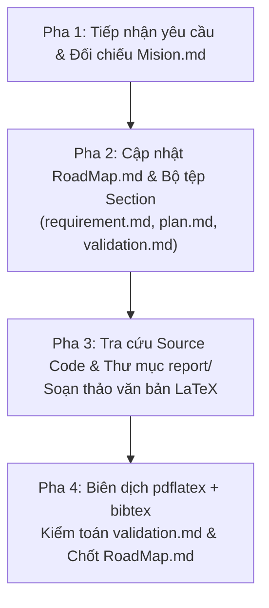

# Academic Paper Authoring & Adaptive Synchronization Protocol

Quy chuẩn hướng dẫn chi tiết dành cho Agent khi tham gia vào quá trình soạn thảo, hiệu đính và nâng cấp bài báo khoa học (Paper) chuẩn quốc tế (IEEE Transactions / Elsevier / Top Conferences).

---

## 1. Triết Lý Cốt Lõi: Nguyên Tắc 3 Không (Core Invariants)

1. **KHÔNG ẢO GIÁC SỐ LIỆU & HÌNH ẢNH (Zero Hallucination & Visual QA Gate):** 
   - Mọi giá trị định lượng (Mask mAP, Mask IoU, AUROC, FAR, MAE, PSNR, SSIM, Latency ms), siêu tham số ($\tau_{\text{peak}}, r_0, \rho_{\text{neg}}, \alpha, \gamma$) và số lượng mẫu ảnh (tách bạch rõ **2,676 ảnh RGB** + **181 ground-truth masks** = 2,857 tệp trên 6 categories) BẮT BUỘC trích xuất 100% từ mã nguồn và kết quả thực tế (`data_engine/`, `evaluation/`, `results/`, `cpp/`).
   - Nếu dữ liệu thực nghiệm chưa có (ví dụ `EXP-01..11` đang chờ quét Colab), BẮT BUỘC giữ ô trống `--` minh bạch; tuyệt đối không đưa kết quả `dry_run: true` lên làm kết quả chính thức mà không chú thích rõ.
   - **Tách bạch Lý thuyết – Thực nghiệm:** Section III (*Methodology*) chỉ trình bày ký hiệu tổng quát và tính chất toán học; chuyển toàn bộ giá trị siêu tham số cụ thể và kết quả đo đạc (kể cả bảng roundtrip `Table I`) sang Section IV sau khi giới thiệu tập dữ liệu. Không chèn con số định lượng chưa có bảng chứng minh (như `>80%`) vào Section III.
   - **Tách bạch thuật ngữ kỹ thuật chuẩn IEEE:** Phân biệt rõ *Unfiltered Identity Roundtrip* ($\mathcal{T}^{-1}(\mathcal{T}(I))$, không lọc, $\text{PSNR}=51.31\text{ dB}$) với bước *Active Filtering* (2D-FFT Notch / 2D-DWT); không gọi biến đổi có $\text{PSNR}<\infty$ là *"lossless"* (dùng *"coordinate-preserving"*). Dùng *"Strict Defect-Free Training Regime"* thay vì coi *"Zero-Data-Leakage"* là đóng góp khoa học mới.
   - **Kiểm tra trực quan hình ảnh bắt buộc:** Trước khi chèn bất kỳ ảnh `.png` nào vào bài, PHẢI mở kiểm tra trực quan để đảm bảo: (i) không dùng ảnh toy test, (ii) ảnh tổng hợp lấy từ mẫu `train/good` hoàn toàn lành, (iii) dùng thanh tiêu đề trắng + chữ đen sắc nét phía trên khung ảnh (không đè chữ màu neon lên ảnh).

2. **KHÔNG LẠC ĐỀ (Anti-Drift Guardrail):** 
   - Tệp `paper/Mision.md` đóng vai trò là "Bản Hiến Pháp / La Bàn Chiến Lược" của toàn bộ bài báo.
   - Mọi thay đổi, đề xuất thêm mô-đun hay sửa đổi nội dung đều phải đối chiếu với `Mision.md`: Nếu nội dung làm loãng 3–4 đóng góp cốt lõi (Contributions) hoặc vi phạm phạm vi nghiên cứu (Scope), Agent phải từ chối hoặc đưa vào phần Thảo luận/Future Work thay vì làm xáo trộn kiến trúc bài viết.

3. **KHÔNG ĐỨT GÃY BIÊN DỊCH (Compilation Integrity):** 
   - Mọi chỉnh sửa mã nguồn LaTeX (`paper/paper.tex` hoặc các tệp `.tex` phân rã) phải được kiểm thử biên dịch 2 vòng bằng `pdflatex` và `bibtex`.
   - Bảo đảm $100\%$ không có cảnh báo tham chiếu gãy (`??`), không thiếu tệp hình ảnh, và kiểm soát nghiêm ngặt lỗi tràn cột (`Overfull \hbox`) trên layout 2 cột chuẩn IEEE.

---

## 2. Kiến Trúc Quản Trị Tài Liệu Đa Tầng (Multi-Tier Hierarchy)

Toàn bộ quá trình viết bài được quản lý bằng cây tài liệu cấu trúc phân cấp chặt chẽ trong thư mục `paper/`:

```text
paper/
├── Mision.md                 # [TẦNG 1] La bàn định hướng: Bài toán, Novelty, 4 Contributions, Giới hạn Scope
├── RoadMap.md                # [TẦNG 2] Bản đồ thực thi: Trạng thái 7 sections, dependencies, tiến độ từng đợt
├── paper.tex                 # [MÃ NGUỒN CHÍNH] Bản thảo LaTeX chuẩn IEEEtran
├── references.bib            # [TRÍCH DẪN] Danh mục tài liệu tham khảo BibTeX
├── figures/                  # [HÌNH ẢNH] Sơ đồ kiến trúc vector và ảnh montage thực nghiệm
└── <section_directory>/      # [TẦNG 3] Không gian làm việc của từng phần (introduction, methodology, ...)
    ├── requirement.md        # Yêu cầu nội dung, luận điểm cần đạt, trích dẫn bắt buộc
    ├── plan.md               # Kế hoạch triển khai chi tiết từng đoạn văn, công thức, bảng biểu
    └── validation.md         # Bộ tiêu chí kiểm định đối chiếu chéo (Code vs Report vs Paper)
```

### Chi tiết vai trò từng tệp:

* **`paper/Mision.md` (La Bàn Chiến Lược):**
  - Chứa: Tiêu đề bài báo chính thức, Tạp chí/Hội nghị mục tiêu, Phát biểu bài toán trung tâm, 4 Đóng góp mới cốt lõi (Novelty & Contributions), Giới hạn phạm vi (Scope & Boundaries), và Danh sách các điều khoản cấm vi phạm (Anti-Drift Invariants).
  - *Tần suất cập nhật:* Chỉ cập nhật khi có quyết định chuyển hướng chiến lược lớn từ người dùng.

* **`paper/RoadMap.md` (Lộ Trình & Tiến Độ Sống):**
  - Chứa: Ma trận trạng thái 7 phần của bài báo (`Section I` đến `Section VII`): `PLANNED`, `IN_PROGRESS`, `DRAFTED`, `VERIFIED`, `FROZEN`.
  - Nhật ký các đợt cập nhật (Changelog): Ngày, mục tiêu đợt sửa, tệp bị ảnh hưởng, người/agent thực hiện.
  - *Tần suất cập nhật:* Bắt buộc cập nhật trước và sau mỗi đợt chỉnh sửa bài viết.

* **Bộ 3 tệp cho từng Section (`paper/<section>/`):**
  - `requirement.md`: Định nghĩa "Đầu vào" và "Yêu cầu cần đạt" (Đoạn 1 viết gì, đoạn 2 lập luận ra sao, công thức nào cần dẫn giải, trích dẫn BibTeX nào bắt buộc phải có).
  - `plan.md`: Kế hoạch viết văn bản theo từng bước nhỏ (Step-by-step), ánh xạ rõ ràng từng dòng code / số liệu từ thư mục `data_engine/`, `report/` vào bài báo.
  - `validation.md`: Bộ câu hỏi kiểm tra nghiêm ngặt (Auditing Checklist) để tự đánh giá trước khi thông báo hoàn tất: Đã đủ công thức chưa? Bảng biểu có khớp số liệu trong `results/` không? Độ dài có vừa vặn 2 cột không?

---

## 3. Quy Trình 4 Pha Vận Hành Tự Động (4-Phase Operational Workflow)

Mỗi khi người dùng đưa ra yêu cầu sửa đổi, Agent BẮT BUỘC thực hiện tuần tự theo 4 pha sau:



### Pha 1: Tiếp nhận Yêu cầu & Đối chiếu Mision.md
- Đọc kỹ yêu cầu chỉnh sửa từ người dùng.
- Mở `paper/Mision.md`, kiểm tra xem yêu cầu này có làm lệch định hướng đề tài không.
- Nếu phù hợp, xác định chính xác (các) Section bị ảnh hưởng.

### Pha 2: Cập nhật RoadMap & Thiết lập Bộ tệp Section
- Mở `paper/RoadMap.md`: Chuyển trạng thái của Section tương ứng sang `IN_PROGRESS`.
- Truy cập vào thư mục của Section (ví dụ `paper/introduction/` hoặc tạo mới nếu chưa có):
  - Khởi tạo hoặc cập nhật `requirement.md` với các tiêu chí cụ thể của đợt sửa này.
  - Viết `plan.md` phân rã kế hoạch thực hiện từng bước rõ ràng.
  - Lập `validation.md` với các tiêu chí đối soát cụ thể.

### Pha 3: Tra cứu Mã nguồn Thực tế & Soạn thảo Văn bản
- **Bắt buộc đọc mã nguồn trước khi viết công thức (Code-Verified Equations):** Mở đọc trực tiếp hàm thực thi (`fft_filter.py`, `dwt_filter.py`, `run_experiment.py`, ...) thay vì chép từ báo cáo cũ để xác minh chính xác phép toán (`median` vs `mean+std`), không gian màu mặc định (`use_luminance=True` YCrCb), giới hạn tham số ($N_{\max}=100$), và thứ tự áp dụng pipeline. Khẳng định dứt khoát cấu hình mặc định, không viết nước đôi (*"may be A or B"*).
- Soạn thảo hoặc sửa đổi mã nguồn LaTeX trong `paper/paper.tex` (hoặc các tệp con).
- Tuân thủ nghiêm ngặt văn phong tiếng Anh học thuật trang trọng (Formal Academic English), sử dụng ngôi bị động hoặc ngôi thứ nhất số nhiều ("We propose...", "It is observed that...").

### Pha 4: Biên dịch Kiểm thử & Nghiệm thu Tự động
- Chạy lệnh biên dịch 2 vòng bằng powershell (BypassSandbox):
  ```powershell
  Set-Location paper
  pdflatex -interaction=nonstopmode -disable-installer paper.tex
  bibtex paper
  pdflatex -interaction=nonstopmode -disable-installer paper.tex
  pdflatex -interaction=nonstopmode -disable-installer paper.tex
  ```
- Kiểm tra mã thoát (`exit code 0`) và tệp log.
- Đối chiếu toàn bộ các tiêu chí trong `validation.md`: Đánh dấu `[x]` vào các mục đã đạt.
- Cập nhật lại `paper/RoadMap.md`: Đánh dấu Section chuyển sang trạng thái `VERIFIED` hoặc `DRAFTED`.

---

## 4. Bảng Ánh Xạ Mã Nguồn & Báo Cáo vào Từng Section Của Paper

Khi viết bất kỳ phần nào trong bài báo, Agent PHẢI sử dụng đúng tệp nguồn tương ứng sau:

| Section trong Paper (5-Section IEEE Conference) | Tệp nguồn trong `report/` & `paper/` | Mã nguồn thực tế trong dự án | Nội dung kỹ thuật bắt buộc trích xuất |
| :--- | :--- | :--- | :--- |
| **I. Introduction** | `paper/sections/introduction.tex`, `report/02_chuong1.md` | `README.md`, `paper/Mision.md` | Nghịch lý dữ liệu, 3 nút thắt xử lý ảnh, 3 đóng góp cốt lõi định lượng, Strict Defect-Free Training Regime. |
| **II. Related Work** | `paper/sections/related_work.tex`, `report/02_chuong1.md` | `paper/references.bib` | Phê phán AD truyền thống (PaDiM, PatchCore), Spatial Synthesis (CutPaste, DRAEM, NSA), Frequency & Optical Robustness (ImageNet-C, MVTec-AD-C) + Positioning. |
| **III. Proposed Methodology** | `paper/sections/methodology.tex`, `report/03`, `04` | `data_engine/frequency/`, `data_engine/synthesizers/`, `data_engine/exporters/` | Thuần lý thuyết & ký hiệu tổng quát: Inter-Domain Coupling, 2D-FFT Notch (YCrCb/RGB), 2D-DWT Haar, Perlin lưới $S_0\times S_0$, NSA Poisson + Otsu, Negative Invariant $\rho_{\text{neg}}$, Suzuki-Abe/RDP & YOLOv11-seg loss. |
| **IV. Experimental Evaluation** | `paper/sections/experiments.tex`, `report/05`, `06` | `evaluation/dual_domain_metrics.py`, `results/metrics/extra_eval/`, `data_engine/corruptions/`, `cpp/trt_seg_inference/` | • Dataset 6 lớp (2,676 RGB + 181 masks), Models & Hyperparameters.<br>• Dual-Domain Metrics (COCO mAP, Mask IoU $|M^*|>0$, Pixel/Image AUROC, $\text{FAR}@\tau_{\text{conf}}$).<br>• Roundtrip Table I, Real Baseline/FAR Table II, Ablation Table III, Qualitative Fig. 2–3.<br>• MVTec-AD-C Robustness (IV-H, Fig. 4, Table IV) & Computational Efficiency (IV-I, Table V: 6.7 ms). |
| **V. Conclusion** | `paper/sections/conclusion.tex`, `report/07_ket_luan_tltk.md` | `paper/Mision.md` | Tổng kết 3 trụ cột Xử lý ảnh, đoạn **Limitations** (3 hạn chế thực chất) và **Future Work** (spectral gating, tiled inference, structural anomalies, VisA). |

---

## 5. Quy Chuẩn Ký Hiệu, Trích Dẫn & Định Dạng LaTeX IEEEtran (Formatting Guidelines)

1. **Bảng biểu & Hình ảnh (Tables & Figures):**
   - Dùng `booktabs` (`\toprule`, `\midrule`, `\bottomrule`, không dùng kẻ dọc `|`), ưu tiên `tabular` gọn gàng tránh `Overfull \hbox`.
   - Hình 1 cột: `\begin{figure}[t]`, hình 2 cột: `\begin{figure*}[!t]`. Mọi hình/bảng bắt buộc phải được tham chiếu trong văn bản (`Fig.~\ref{...}`, `Table~\ref{...}`).

2. **Ký hiệu Toán học Toàn bài & Chuẩn Phương Pháp (Global Symbol De-Collision & Rigor):**
   - Rà soát trùng lặp ký hiệu **xuyên suốt tất cả Sections** (tách biệt $C/\mathcal{C}$; $(u,v)/(s,t)/d\ell/q_i$; $K/N_v$; $r_0, r_{\text{inner}}/r_{\text{aspect}}$; $\theta/\phi$; $P/A$; $g_i/f$; $\tau_{\text{peak}}, \tau_{\text{perlin}}/\tau_{\text{conf}}$) và đồng bộ mọi tham số mới ($N_{\max}=100$) sang Section IV-B.
   - Dùng **lực lượng tập hợp** cho tỷ lệ mẫu âm mini-batch ($\mathcal{B} = \mathcal{B}_{\text{syn}} \cup \mathcal{B}_{\text{clean}}, \; |\mathcal{B}_{\text{clean}}|/|\mathcal{B}| = \rho_{\text{neg}}$; cấm nhân vô hướng với tập hợp), khẳng định mẫu âm $\mathcal{B}_{\text{clean}}$ vẫn đi qua $\mathcal{T}_{\text{freq}}$ (chống Domain Mismatch), viết đầy đủ trọng số hàm mất mát ($\lambda_{\text{box}}, \lambda_{\text{cls}}, \lambda_{\text{mask}}, \lambda_{\text{dfl}}$), và lược bỏ chi tiết cài đặt thư viện thừa (như `M in {0, 255}` của OpenCV).
   - Mọi phương trình cốt lõi phải có `\label{eq:...}` và được viện dẫn bằng `\eqref{...}`; dùng `align` để ngắt dòng phương trình dài, tránh `Overfull \hbox`.

3. **Trích dẫn Học thuật Thực chứng & Chuẩn SOTA Related Work:**
   - Xác thực 100% mọi mục trong `references.bib` là công trình có thật và đúng loại (`@inproceedings` vs `@article` để không mất `booktitle`), tránh gắn nhầm citation gốc ImageNet-C (`hendrycks2019robustness`) cho MVTec-AD-C (`chen2023mvtecadc`).
   - Cập nhật SOTA gần nhất (2023–2025: `SimpleNet`, `EfficientAD`, `DeSTSeg`, `RealNet`, `FAIR`, `Omni-Frequency`); không đưa lỗi cài đặt phần mềm (như *Power-of-Two broadcast bug*) vào danh sách hạn chế khoa học ở Related Work; tạo cầu nối mượt sang kiến trúc chính (họ YOLO) trước đoạn *Positioning*, và tránh lặp cấu trúc câu với Section I.
   - Không lặp thừa `\cite{}` trong cùng một section; gộp trích dẫn liền kề thành `[7, 8]` theo skill `ieee-citation-formatting` (dùng patch `\@citex` offline-safe khi không có `cite.sty`).

4. **Văn phong & Cú pháp `IEEEtran` chuẩn:**
   - Mở đầu Section I bằng `\IEEEPARstart{I}{n}`, không dùng `\indent` dư thừa ở đầu đoạn mới.
   - Dùng `Section~\ref{...}` (không dùng `Subsection`), dùng `---` thay cho dấu gạch dài Unicode `—`, mở rộng từ viết tắt lần đầu trong chính văn (tách biệt với Abstract), và tránh từ ngữ cường điệu (*fatal, catastrophic, flawless, rampant*).
