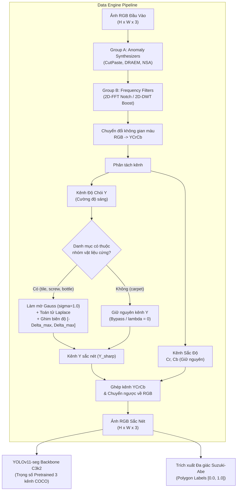

# Thiết Kế Kỹ Thuật: Tiền Xử Lý Tăng Cường Biên Ảnh Bằng Toán Tử Laplacian (Boundary-Guided LoG Luminance Sharpening)

> **Mục đích tài liệu:** Tài liệu này đặc tả chi tiết kiến trúc giải pháp, cơ sở toán học, thiết kế mô-đun mã nguồn, cấu hình siêu tham số và quy trình thực nghiệm cho nhánh nghiên cứu **Laplacian-based Input Sharpening**. Khi bắt đầu kích hoạt triển khai nhánh này, lập trình viên/nghiên cứu viên chỉ cần tuân theo lộ trình từng bước được quy định tại đây.

---

## 1. Tổng Quan & Động Lực Nghiên Cứu

### 1.1. Bối cảnh bài toán và hạn chế hiện tại
Trong hệ thống phân vùng khuyết tật bề mặt công nghiệp hiện hành (kết hợp sinh lỗi tổng hợp Group A, lọc miền tần số Group B và mô hình YOLOv11-seg), báo cáo thực nghiệm (mục `3.4.2` trong `report/06_chuong3_part2.md`) đã chỉ ra một số điểm nghẽn kỹ thuật:
- **Vết nứt vi mô có độ tương phản mờ nhạt (`tile_crack`):** Độ chênh lệch cường độ sáng giữa khe nứt men gạch và vân đá tự nhiên quá thấp. Khi đi qua các tầng tích chập giảm mẫu (Strided Convolutions / Pooling) của mạng nơ-ron sâu, tín hiệu biên vết nứt bị làm phẳng (smoothing), dẫn đến hiện tượng mặt nạ dự báo bị phân mảnh hoặc đa giác Douglas-Peucker bị gom cụm quá đà (**Over-segmentation**).
- **Suy thoái quang học do mất nét thấu kính (`Defocus Blur` trong MVTec-AD-C):** Khi camera bị rung lắc làm lệch tiêu cự, đĩa tán xạ ánh sáng (Airy disk) làm nhòe các cạnh chuyển tiếp đột ngột, khiến độ chính xác Mask mAP sụt giảm nghiêm trọng.

### 1.2. Giải pháp đề xuất
Ứng dụng **toán tử Laplacian of Gaussian (LoG)** trên **kênh độ chói (Luminance $Y$)** trong không gian màu $YCrCb$/$Lab$ có kiểm soát biên độ biến thiên (Bounded Scaled Sharpening) và cơ chế thích nghi theo danh mục (Category-Adaptive).

---

## 2. Cơ Sở Toán Học & Giải Tích Ảnh Số

### 2.1. Toán tử Laplace trong không gian ảnh số 2 chiều
Toán tử Laplace là toán tử vi phân bậc hai vô hướng bất biến với phép quay (isotropic), được định nghĩa trong không gian liên tục:
$$\nabla^2 f(x, y) = \frac{\partial^2 f}{\partial x^2} + \frac{\partial^2 f}{\partial y^2}$$

Trong miền rời rạc của ma trận điểm ảnh $I(x, y)$, xấp xỉ đạo hàm bậc hai theo sai phân trung tâm:
$$\frac{\partial^2 I}{\partial x^2} \approx I(x+1, y) - 2I(x, y) + I(x-1, y)$$
$$\frac{\partial^2 I}{\partial y^2} \approx I(x, y+1) - 2I(x, y) + I(x, y-1)$$

Tổng hợp lại ta có toán tử Laplace rời rạc chuẩn 4 hướng:
$$\nabla^2 I(x, y) = I(x+1, y) + I(x-1, y) + I(x, y+1) + I(x, y-1) - 4I(x, y)$$

Ma trận nhân chập (Convolution Kernel) tương ứng:
$$K_{Lap} = \begin{bmatrix} 0 & 1 & 0 \\ 1 & -4 & 1 \\ 0 & 1 & 0 \end{bmatrix} \quad \text{hoặc phiên bản 8 hướng:} \quad K'_{Lap} = \begin{bmatrix} 1 & 1 & 1 \\ 1 & -8 & 1 \\ 1 & 1 & 1 \end{bmatrix}$$

### 2.2. Đặc tính Điểm Chuyển Tiếp Qua 0 (Zero-Crossing)
Đạo hàm bậc nhất ($\nabla I$) đạt cực trị tại vị trí dốc cạnh, trong khi đạo hàm bậc hai ($\nabla^2 I$) đổi dấu từ dương sang âm (hoặc ngược lại) và đi qua điểm giá trị 0 (**Zero-Crossing**) tại đúng tâm hình học của biên cạnh. Tính chất này cho phép định vị vị trí vết rạn nứt tế vi với độ phân giải cấp độ dưới điểm ảnh (sub-pixel).

### 2.3. Triệt tiêu nhiễu hạt bằng Laplacian of Gaussian (LoG)
Do đạo hàm bậc hai đóng vai trò như một bộ lọc thông cao mạnh, nó làm khuếch đại nhiễu hạt cảm biến tỷ lệ thuận với bình phương tần số ($\omega^2$). Để triệt tiêu hiện tượng này, ảnh trước hết được làm mờ nhẹ bằng hàm phân bố Gauss 2 chiều:
$$G_\sigma(x, y) = \frac{1}{2\pi \sigma^2} \exp\left( -\frac{x^2 + y^2}{2\sigma^2} \right)$$

Nhờ tính chất tuyến tính của phép tích chập, toán tử Laplace có thể kết hợp trực tiếp với đạo hàm của hàm Gauss:
$$\text{LoG}(x, y) = \nabla^2 \Big( G_\sigma(x, y) * Y(x, y) \Big) = \left( \nabla^2 G_\sigma(x, y) \right) * Y(x, y)$$
$$\nabla^2 G_\sigma(x, y) = -\frac{1}{\pi \sigma^4} \left( 1 - \frac{x^2 + y^2}{2\sigma^2} \right) \exp\left( -\frac{x^2 + y^2}{2\sigma^2} \right)$$

### 2.4. Công thức tăng cường độ nét có chặn biên độ (Bounded Sharpening)
Để khôi phục biên mà không làm phát sinh quầng sáng ảo (Halo/Ringing artifacts) quanh các chi tiết tương phản mạnh, độ biến thiên được giới hạn bởi ngưỡng chặn $\Delta_{\max}$:
$$\Delta Y(x, y) = \operatorname{clip}\Big( \lambda \cdot \text{LoG}(x, y), \, -\Delta_{\max}, \, \Delta_{\max} \Big)$$
$$Y_{sharp}(x, y) = \operatorname{clip}\Big( Y(x, y) - \Delta Y(x, y), \, 0, \, 255 \Big)$$
*Trong đó:*
* $\lambda \in [0.2, 0.5]$ là hệ số khuếch đại độ dốc biên.
* $\Delta_{\max} \in [20, 30]$ là biên độ gia giảm tối đa cho phép trên thang 256 mức xám.

---

## 3. Kiến Trúc Tích Hợp & Sơ Đồ Quy Trình

### 3.1. Sơ đồ luồng dữ liệu (Data Pipeline Flow)



### 3.2. Lý do chọn kênh độ chói $Y$ thay vì RGB hay 4 kênh
1. **Chống hiện tượng lệch màu (Color Fringing):** Trong không gian RGB, 3 kênh màu có giá trị gradient khác nhau tại biên. Áp dụng Laplacian riêng rẽ từng kênh làm méo tỷ lệ tỷ sắc, tạo viền màu tím/đỏ giả tạo. Kênh $Y$ mang trọn vẹn thông tin cảm nhận hình học của mắt người.
2. **Tương thích tuyệt đối với Transfer Learning của YOLOv11:** Giữ nguyên đầu vào $3$ kênh ($C=3$), tái sử dụng $100\%$ bộ trọng số đã huấn luyện trước trên COCO mà không phải khởi tạo ngẫu nhiên lại lớp tích chập đầu tiên.

---

## 4. Chiến Lược Thích Nghi Theo Danh Mục (Category-Adaptive Strategy)

| Danh mục | Nhóm vật liệu | Mức độ kích hoạt ($\lambda$) | Tham số $\sigma$ | $\Delta_{\max}$ | Lý do kỹ thuật |
| :--- | :--- | :---: | :---: | :---: | :--- |
| **`tile`** | Men gạch, đá | **0.45 (Mạnh)** | $1.0$ | $30$ | Khắc phục trực diện vết nứt mảnh `crack` và vết dính keo `glue_strip`. |
| **`screw`** | Kim loại | **0.40 (Mạnh)** | $0.8$ | $25$ | Làm sắc nét rãnh ren `thread_side` và vết cào xước vi mô `scratch_head`. |
| **`bottle`** | Thủy tinh | **0.35 (Vừa)** | $1.0$ | $25$ | Làm rõ mép vỡ `broken_large` và `broken_small` tại miệng chai. |
| **`pill`** | Dược phẩm | **0.30 (Vừa)** | $1.0$ | $20$ | Làm nổi bật vết mẻ cạnh `faulty_imprint` mà không làm vỡ bề mặt phấn. |
| **`grid`** | Lưới thép | **0.20 (Nhẹ)** | $1.2$ | $15$ | Hỗ trợ phát hiện sợi đứt `broken`, tránh khuếch đại bóng kim loại. |
| **`carpet`** | Vải dệt sợi | **0.00 (Tắt)** | -- | -- | **Bắt buộc tắt** để tránh khuếch đại xơ len ngẫu nhiên, giữ $\text{FAR}=0.000$. |

---

## 5. Đặc Tả Mã Nguồn Chuẩn Hóa

### 5.1. Định nghĩa Processor trong `data_engine/frequency/log_sharpening_filter.py`

```python
"""
Mô-đun Boundary-Guided LoG Luminance Sharpening.
Tăng cường ranh giới vi mô bằng toán tử Laplacian of Gaussian trên kênh độ chói.
"""

from typing import Dict, Any, Optional
import cv2
import numpy as np

from data_engine.base import BaseProcessor
from data_engine.sample import Sample


class AdaptiveLoGSharpeningFilter(BaseProcessor):
    """
    Bộ lọc tăng cường độ nét ranh giới bằng Laplacian of Gaussian (LoG) thích nghi.
    """

    # Bảng siêu tham số thích nghi theo từng danh mục
    CATEGORY_CONFIGS = {
        "tile":   {"enabled": True,  "lambda_weight": 0.45, "sigma": 1.0, "max_delta": 30.0},
        "screw":  {"enabled": True,  "lambda_weight": 0.40, "sigma": 0.8, "max_delta": 25.0},
        "bottle": {"enabled": True,  "lambda_weight": 0.35, "sigma": 1.0, "max_delta": 25.0},
        "pill":   {"enabled": True,  "lambda_weight": 0.30, "sigma": 1.0, "max_delta": 20.0},
        "grid":   {"enabled": True,  "lambda_weight": 0.20, "sigma": 1.2, "max_delta": 15.0},
        "carpet": {"enabled": False, "lambda_weight": 0.00, "sigma": 1.0, "max_delta": 0.00},
    }

    def __init__(
        self,
        default_lambda: float = 0.35,
        default_sigma: float = 1.0,
        default_max_delta: float = 25.0,
        adaptive: bool = True
    ):
        """
        Khởi tạo bộ lọc LoG Sharpening.
        """
        self.default_lambda = default_lambda
        self.default_sigma = default_sigma
        self.default_max_delta = default_max_delta
        self.adaptive = adaptive

    def process(self, sample: Sample) -> Sample:
        """
        Thực hiện tăng cường độ nét trên kênh độ chói của mẫu dữ liệu.
        Mặt nạ phân vùng nhị phân (mask) và nhãn giữ nguyên 100%.
        """
        category = sample.category.lower() if sample.category else ""
        cfg = self.CATEGORY_CONFIGS.get(category, {
            "enabled": True,
            "lambda_weight": self.default_lambda,
            "sigma": self.default_sigma,
            "max_delta": self.default_max_delta
        }) if self.adaptive else {
            "enabled": True,
            "lambda_weight": self.default_lambda,
            "sigma": self.default_sigma,
            "max_delta": self.default_max_delta
        }

        # Nếu danh mục bị vô hiệu hóa (ví dụ carpet) -> trả về nguyên bản
        if not cfg["enabled"] or cfg["lambda_weight"] <= 0.0:
            return sample

        image = sample.image
        # 1. Chuyển đổi sang không gian màu YCrCb
        ycrcb = cv2.cvtColor(image, cv2.COLOR_RGB2YCrCb)
        y_channel = ycrcb[:, :, 0].astype(np.float32)

        # 2. Làm mờ Gauss giảm nhiễu trước khi tính đạo hàm
        sigma = cfg["sigma"]
        blurred_y = cv2.GaussianBlur(y_channel, (0, 0), sigmaX=sigma, sigmaY=sigma)

        # 3. Tính toán đạo hàm bậc hai qua toán tử Laplace (ksize=3)
        laplacian = cv2.Laplacian(blurred_y, cv2.CV_32F, ksize=3)

        # 4. Tính toán độ biến thiên và ghim biên độ chống hiệu ứng halo
        lambda_w = cfg["lambda_weight"]
        max_delta = cfg["max_delta"]
        delta = np.clip(lambda_w * laplacian, -max_delta, max_delta)

        # 5. Tăng cường độ nét kênh Y và cắt ngọn miền [0, 255]
        y_sharp = np.clip(y_channel - delta, 0.0, 255.0).astype(np.uint8)
        ycrcb[:, :, 0] = y_sharp

        # 6. Chuyển ngược về không gian RGB
        sharpened_image = cv2.cvtColor(ycrcb, cv2.COLOR_YCrCb2RGB)

        # 7. Cập nhật vào sample và ghi nhật ký metadata
        new_sample = sample.clone()
        new_sample.image = sharpened_image
        new_sample.metadata["log_sharpening_applied"] = True
        new_sample.metadata["log_lambda"] = lambda_w
        new_sample.metadata["log_sigma"] = sigma

        return new_sample
```

---

## 6. Thiết Kế Thí Nghiệm Đánh Giá Khi Kích Hoạt (Kịch Bản EXP-12)

Khi kích hoạt nhánh này, tạo tệp cấu hình thực nghiệm tại `configs/experiments/exp12_log_sharpening.yaml`:

```yaml
experiment:
  id: "EXP-12"
  name: "Adaptive LoG Sharpening with YOLOv11-seg"
  description: "Boundary-guided Laplacian of Gaussian luminance sharpening on crack-sensitive categories"
  seed: 42

data:
  dataset_name: "mvtec_ad"
  root_dir: "./mvtec_ad"
  categories: ["tile", "screw", "bottle", "pill", "grid", "carpet"]
  good_ratio: 0.15
  imgsz: 640

pipeline:
  synthesizer:
    name: "cutpaste"
    mode: "mixed"
  frequency_filter:
    name: "log_sharpening"
    adaptive: true
    default_lambda: 0.35
    default_sigma: 1.0
    default_max_delta: 25.0

training:
  model: "yolo11n-seg.pt"
  epochs: 50
  batch: 16
  optimizer: "AdamW"
  lr0: 0.001

evaluation:
  metrics: ["mask_map50", "mask_map50_95", "pixel_auroc", "image_auroc", "far_025"]
  robustness_benchmark: true  # Chạy kiểm thử trên tập MVTec-AD-C
```

---

## 7. Các Bài Kiểm Thử Tự Động Bắt Buộc (Unit Tests Checklist)

Trước khi chạy huấn luyện, tệp `tests/test_log_sharpening.py` cần được tạo để xác minh các bất biến:

1. **Bảo toàn hình học ma trận (Shape Invariant):**
   $$\operatorname{shape}(I_{sharp}) \equiv \operatorname{shape}(I_{raw}) \equiv (H, W, 3)$$
2. **Bảo toàn không gian màu và kiểu dữ liệu (Type Invariant):**
   Kiểu dữ liệu đầu ra bắt buộc là `np.uint8`, dải giá trị $[0, 255]$.
3. **Bảo toàn mặt nạ nhị phân tuyệt đối (Mask Invariance):**
   $$M_{sharp} \equiv M_{raw} \quad \text{trên toàn bộ tọa độ } (x, y)$$
4. **Kiểm tra cơ chế Bypass đối với `carpet` (Negative Preservation):**
   Ảnh `carpet` sau khi đi qua bộ lọc phải bằng $100\%$ ảnh gốc ($\text{MAE} == 0.0$).
5. **Kiểm tra mức độ tăng độ tương phản biên trên ảnh tổng hợp (Edge Contrast Boost):**
   Độ chênh lệch gradient tại biên một hình vuông nhân tạo sau khi qua bộ lọc phải lớn hơn ảnh gốc:
   $$\|\nabla Y_{sharp}\|_{border} > \|\nabla Y_{raw}\|_{border}$$

---

## 8. Lộ Trình Triển Khai Nhanh Khi Bắt Đầu (Actionable Steps)

Khi quyết định triển khai nhánh này vào hệ thống, chỉ cần thực hiện tuần tự 5 bước:

- [ ] **Bước 1:** Tạo file `data_engine/frequency/log_sharpening_filter.py` và dán mã nguồn từ Mục 5.1.
- [ ] **Bước 2:** Đăng ký processor mới vào `data_engine/pipeline.py` (trong hàm builder đọc từ cấu hình YAML).
- [ ] **Bước 3:** Thêm bài kiểm thử `tests/test_log_sharpening.py` và chạy `pytest tests/ -v` để đảm bảo 100% test pass.
- [ ] **Bước 4:** Tạo file cấu hình `configs/experiments/exp12_log_sharpening.yaml`.
- [ ] **Bước 5:** Thực thi thử nghiệm cục bộ kiểm chứng:
  ```bash
  python experiments/run_experiment.py --config configs/experiments/exp12_log_sharpening.yaml --dry-run
  ```
- [ ] **Bước 6:** Đẩy lên Google Colab GPU A100 chạy huấn luyện 50 epochs và đối sánh kết quả cải thiện Mask mAP so với `EXP-01` trên danh mục `tile`.
