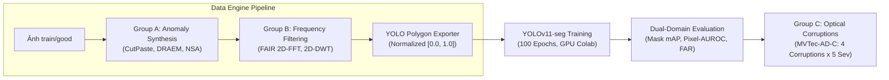

<div align="center">

# YOLOv11-seg Industrial Defect Segmentation Research Framework
### Khung Nghiên Cứu Phân Vùng Khuyết Tật Công Nghiệp trên MVTec AD Kết Hợp Sinh Lỗi Nhân Tạo, Miền Tần Số và Độ Bền Quang Học

[](https://www.python.org/)
[](https://github.com/ultralytics/ultralytics)
[](https://pywavelets.readthedocs.io/)
[](https://www.mvtec.com/company/research/datasets/mvtec-ad)
[](tests/)
[-success.svg?style=flat)]()
[](LICENSE)

<p align="center">
  <b>Phát hiện & Phân vùng lỗi bề mặt công nghiệp cấp độ pixel kết hợp mô hình YOLOv11-seg với 3 hướng nghiên cứu cốt lõi: Anomaly Synthesis (Group A), Frequency Preprocessing (Group B), và Optical Robustness Evaluation (Group C).</b>
</p>

</div>

---

## 📑 Mục Lục
- [1. Ý Tưởng & Mục Tiêu Nghiên Cứu](#1-ý-tưởng--mục-tiêu-nghiên-cứu)
- [2. Ba Hướng Nghiên Cứu Trọng Tâm](#2-ba-hướng-nghiên-cứu-trọng-tâm)
  - [Nhóm A: Sinh Lỗi Nhân Tạo (Synthetic Anomaly Generation)](#nhóm-a-sinh-lỗi-nhân-tạo-synthetic-anomaly-generation)
  - [Nhóm B: Tiền Xử Lý Miền Tần Số (Frequency Domain Preprocessing)](#nhóm-b-tiền-xử-lý-miền-tần-số-frequency-domain-preprocessing)
  - [Nhóm C: Đánh Giá Độ Bền Quang Học (MVTec-AD-C Robustness)](#nhóm-c-đánh-giá-độ-bền-quang-học-mvtec-ad-c-robustness)
- [3. Ma Trận 12 Thí Nghiệm (EXP-00 đến EXP-11)](#3-ma-trận-12-thí-nghiệm-exp-00-đến-exp-11)
- [4. Hệ Thống Đánh Giá Kép Dual-Domain Metrics](#4-hệ-thống-đánh-giá-kép-dual-domain-metrics)
- [5. Cấu Trúc Thư Mục Dự Án](#5-cấu-trúc-thư-mục-dự-án)
- [6. Hướng Dẫn Cài Đặt & Chạy Nhanh](#6-hướng-dẫn-cài-đặt--chạy-nhanh)
  - [Môi Trường Local (Windows / Linux)](#a-môi-trường-local-windows--linux)
  - [Tải Nhanh 6 Danh Mục MVTec AD qua CDN](#b-tải-nhanh-6-danh-mục-mvtec-ad-qua-cdn)
  - [Chạy Kiểm Thử Tự Động (Unit Tests)](#c-chạy-kiểm-thử-tự-động-unit-tests)
  - [Huấn Luyện Trên Google Colab (1-Click Runner)](#d-huấn-luyện-trên-google-colab-1-click-runner)
- [7. Mở Rộng: Triển Khai C++ / TensorRT Trên Thiết Bị Biên](#7-mở-rộng-triển-khai-c--tensorrt-trên-thiết-bị-biên)
- [8. Trích Dẫn & Bản Quyền](#8-trích-dẫn--bản-quyền)

---

## 1. Ý Tưởng & Mục Tiêu Nghiên Cứu

Trong môi trường sản xuất công nghiệp, số lượng sản phẩm lỗi (anomalies) cực kỳ hiếm và đa dạng về hình thái, khiến việc thu thập dữ liệu có nhãn lỗi để huấn luyện các mạng nơ-ron sâu giám sát (như YOLO-seg) gặp trở ngại lớn.

Dự án này xây dựng một **Khung nghiên cứu thực nghiệm tái lập (Reproducible Experimental Framework)** kết hợp kiến trúc phân vùng đối tượng hiện đại **YOLOv11-seg** với các kỹ thuật thị giác máy tính tiên tiến nhằm giải quyết 3 bài toán:
1. **Huấn luyện không rò rỉ dữ liệu (Zero Data Leakage)**: Tuyệt đối không dùng ảnh lỗi thật của tập Test để train. Toàn bộ khuyết tật phục vụ huấn luyện được sinh nhân tạo chỉ từ ảnh bình thường (`train/good`).
2. **Kiểm soát Báo động giả (False Alarm Rate - FAR)**: Giữ lại tỷ lệ mẫu âm tính sạch (`good_ratio: 0.15`) để dạy mô hình không bắt nhầm bề mặt bình thường.
3. **Nâng cao độ bền với biến dạng quang học (Optical Degradation)**: Khảo sát xem các bộ tiền xử lý tần số và sinh lỗi có giúp mô hình giữ vững độ chính xác khi camera bị rung, mờ tiêu cự hoặc nhiễu cảm biến trong nhà máy hay không.

Phạm vi thực nghiệm tập trung vào **6 danh mục đại diện của MVTec AD**:
- **3 Nhóm Hoa văn (Textures)**: `grid`, `carpet`, `tile`.
- **3 Nhóm Vật thể (Objects)**: `screw`, `pill`, `bottle`.

---

## 2. Ba Hướng Nghiên Cứu Trọng Tâm



### Nhóm A: Sinh Lỗi Nhân Tạo (Synthetic Anomaly Generation)
Triển khai các cơ chế tổng hợp bất thường từ các bài báo khoa học chuẩn:
* **CutPaste** (*Li et al., CVPR 2021*): Cắt miếng vá ngẫu nhiên, xoay góc $[-45^\circ, 45^\circ]$, đổi tỷ lệ và dán ngược lại ảnh với 2 chế độ:
  - `normal`: Vết cắt dạng hình chữ nhật tiêu chuẩn.
  - `scar`: Vết cắt dạng dải hẹp, mô phỏng vết cào xước kim loại vi mô.
* **DRAEM** (*Zavrtanik et al., ICCV 2021*): Thuật toán sinh nhiễu Perlin đa thang đo (Multi-octave Perlin noise) kết hợp nội suy làm mờ biên và hòa trộn cấu trúc tự thân (Self-texture beta-blending). Hỗ trợ kích thước ảnh công nghiệp bất kỳ qua phép sinh lưới chuẩn và nội suy song tuyến.
* **NSA (Natural Synthetic Anomalies)** (*Schlüter et al., ECCV 2022*): Thuật toán trích xuất miếng vá biến đổi màu sắc kết hợp hòa trộn ảnh liền mạch Poisson (`cv2.seamlessClone`). Tích hợp bộ phân đoạn tiền cảnh Otsu tự động cho nhóm Object (`screw`, `pill`, `bottle`) để ép lỗi chỉ nằm trọn trong thân vật thể.

### Nhóm B: Tiền Xử Lý Miền Tần Số (Frequency Domain Preprocessing)
* **FAIR 2D-FFT Periodic Suppression**:
  - Chuyển đổi ảnh sang miền Fourier 2D (`np.fft.fft2`, `fftshift`).
  - Tự động phát hiện các đỉnh tần số tuần hoàn bằng ngưỡng thống kê $\tau \cdot \text{median}(|F|)$.
  - Áp dụng bộ lọc triệt tiêu Gaussian notch và tái tạo ngược về ảnh không gian RGB qua `ifft2` (giúp xóa bỏ vân lưới hoa văn gây nhiễu trên `grid`, `carpet`).
* **2D-DWT Wavelet Sub-band Decomposition**:
  - Phân rã ảnh thành 4 dải tần số: xấp xỉ thấp $LL$, chi tiết ngang $LH$, chi tiết dọc $HL$, chi tiết chéo $HH$ qua biến đổi sóng con Haar/db2.
  - Tinh chỉnh năng lượng: Suy giảm nền $\alpha \cdot LL$ ($\alpha=0.6$) và khuếch đại chi tiết biên $\gamma \cdot (LH + HL + HH)$ ($\gamma=1.4$).
  - Tái tạo không gian qua 2D-IDWT với độ trung thực gần như hoàn hảo ($\text{PSNR} > 51\text{ dB}$, $\text{SSIM} > 0.998$).

### Nhóm C: Đánh Giá Độ Bền Quang Học (MVTec-AD-C Robustness)
Đo lường độ ổn định của mô hình trước các suy giảm môi trường thực tế qua 4 phép biến đổi $\times$ 5 mức độ nghiêm trọng:
1. **Gaussian Noise**: Nhiễu hạt cảm biến camera trong điều kiện thiếu sáng.
2. **Gaussian Blur**: Hiện tượng mất nét nhẹ.
3. **Motion Blur**: Vệt mờ chuyển động khi băng chuyền di chuyển nhanh.
4. **Defocus Blur**: Sai lệch tiêu cự thấu kính quang học.
- Xuất toàn bộ đường cong suy biến (Degradation Curves) ra định dạng CSV và JSON.

---

## 3. Ma Trận 12 Thí Nghiệm (EXP-00 đến EXP-11)

Toàn bộ 12 thí nghiệm được cấu hình chi tiết tại [configs/experiments/](configs/experiments/):

| Thí Nghiệm | Kiến Trúc & Dữ Liệu Huấn Luyện | Cấu Hình Tăng Cường | Đánh Giá Mục Tiêu | Câu Hỏi Khoa Học Trả Lời |
| :---: | :--- | :--- | :--- | :--- |
| **EXP-00** | YOLOv11-seg (RGB) | Zero-leakage Baseline (train/good + 15% negative) | Clean Test Set | Năng lực nền tảng của YOLOv11-seg khi không có lỗi nhân tạo? |
| **EXP-01** | YOLOv11-seg (RGB) | CutPaste (`scar` + `normal`) | Clean Test Set | Vết cắt dán hình học nâng Mask mAP và Pixel-AUROC bao nhiêu? |
| **EXP-02** | YOLOv11-seg (RGB) | DRAEM (Perlin Noise đa thang đo) | Clean Test Set | Nhiễu Perlin liên tục có vượt trội hơn miếng dán hình học? |
| **EXP-03** | YOLOv11-seg (RGB) | NSA (Hòa trộn Poisson liền mạch) | Clean Test Set | Hòa trộn Poisson biên mịn có giúp tăng độ chính xác biên mask? |
| **EXP-04** | YOLOv11-seg (FFT-recon) | FAIR 2D-FFT triệt tiêu đỉnh tuần hoàn | Clean Test Set | Lọc notch tần số có triệt nhiễu vân nền cho nhóm `grid`/`carpet`? |
| **EXP-05** | YOLOv11-seg (DWT-recon) | 2D-DWT khuếch đại dải chi tiết cao | Clean Test Set | Tăng cường biên tần số cao có bắt được lỗi vi mô của `screw`? |
| **EXP-06** | YOLOv11-seg (FFT-recon) | CutPaste + FAIR 2D-FFT | Clean Test Set | Sự kết hợp giữa sinh lỗi nhân tạo và lọc tần số FFT? |
| **EXP-07** | YOLOv11-seg (DWT-recon) | CutPaste + 2D-DWT | Clean Test Set | Sự kết hợp giữa sinh lỗi nhân tạo và khuếch đại sóng con DWT? |
| **EXP-08** | YOLOv11-seg (RGB) | Mô hình EXP-00 đánh giá trên MVTec-AD-C | MVTec-AD-C (Sev 1–5) | Tốc độ suy giảm của Baseline khi camera bị rung mờ? |
| **EXP-09** | YOLOv11-seg (RGB) | Mô hình CutPaste đánh giá trên MVTec-AD-C | MVTec-AD-C (Sev 1–5) | Dữ liệu sinh lỗi nhân tạo có làm tăng độ bền trước biến dạng? |
| **EXP-10** | YOLOv11-seg (DWT-recon)| Mô hình 2D-DWT đánh giá trên MVTec-AD-C | MVTec-AD-C (Sev 1–5) | Bộ lọc tần số có hoạt động như lớp bảo vệ trước rung mờ? |
| **EXP-11** | YOLOv11-seg (Full) | Hệ thống toàn diện: CutPaste + DWT | MVTec-AD-C (Sev 1–5) | Đánh giá tổng lực hệ thống trên cả tập Clean và Corrupted. |

---

## 4. Hệ Thống Đánh Giá Kép Dual-Domain Metrics

Module [evaluation/dual_domain_metrics.py](evaluation/dual_domain_metrics.py) cung cấp cơ chế đánh giá song hành chuẩn mực giữa 2 lĩnh vực:

1. **Computer Vision Instance Segmentation**:
   - **Mask mAP@50**, **Mask mAP@50-95**: Đo đạc độ chính xác phân vùng đa giác.
   - **Mask IoU**: Độ trùng khớp giữa polygon dự đoán và Ground-Truth mask.
2. **Industrial Anomaly Detection**:
   - **Pixel Anomaly Probability Map**: Chuyển đổi instance masks và confidences của YOLO thành bản đồ xác suất liên tục $P(y, x) = \max_i(c_i \cdot m_i(y, x))$ trên toàn bộ kích thước $(H, W)$.
   - **Pixel-level AUROC**: Tính theo chuẩn bài báo ADer (`roc_auc_score(gt_px, pr_px)`) trên toàn bộ pixel tập Test.
   - **Image-level AUROC**: So sánh $\max(\text{conf}_i)$ của ảnh với nhãn nhị phân ($defect=1, good=0$).
   - **False Alarm Rate (FAR)**: Đo tỷ lệ báo động giả trên tập `test/good` tại ngưỡng tin cậy $0.25$ và $0.50$.
   - **Phân tách nhóm kết quả**: Báo cáo riêng biệt cho nhóm **Texture** (`grid`, `carpet`, `tile`) và nhóm **Object** (`screw`, `pill`, `bottle`).

---

## 5. Cấu Trúc Thư Mục Dự Án

```text
industrial-defect-segmentation/
├── .agents/                          # Quy tắc & Kỹ năng chuẩn Antigravity
│   ├── rules/
│   │   └── industrial-defect-detection.md   # Zero-leakage & Negative sample invariants
│   └── skills/
│       └── github-code-mining/SKILL.md      # Quy trình khai thác & refactor paper code
├── configs/
│   └── experiments/                  # 12 file YAML thí nghiệm (exp00 -> exp11)
├── data_engine/                      # Động cơ tiền xử lý và sinh lỗi
│   ├── sample.py                     # Cấu trúc dữ liệu chuẩn Sample
│   ├── base.py                       # BaseProcessor, BaseDatasetLoader, Pipeline
│   ├── loaders/                      # MVTecLoader (deterministic splitting) & VisALoader
│   ├── synthesizers/                 # CutPasteSynthesizer, DRAEMSynthesizer, NSASynthesizer
│   ├── frequency/                    # FFTPeriodicSuppressionFilter, DWTSubbandFilter
│   ├── corruptions/                  # MVTec-AD-C parametric optical corruptions
│   └── exporters/                    # YOLOSegExporter (polygon normalized [0.0, 1.0])
├── evaluation/                       # Đánh giá đa chiều
│   ├── dual_domain_metrics.py        # Mask mAP + Pixel AUROC + Image AUROC + FAR
│   └── robustness_evaluator.py       # Xuất đường cong suy giảm MVTec-AD-C ra CSV/JSON
├── experiments/                      # Điều phối thực nghiệm
│   ├── run_experiment.py             # Master script chạy cấu hình YAML (--dry-run, --seed)
│   ├── ablation_matrix.py            # Tổng hợp bảng so sánh Markdown & CSV tự động
│   └── colab_runner.ipynb            # Notebook 1-click chạy trên Google Colab GPU
├── runs/
│   └── verification/                 # Báo cáo thẩm định & 28 ảnh visual montages
├── tests/                            # 34 bài kiểm thử đơn vị tự động (100% PASS)
│   ├── test_data_engine.py
│   ├── test_synthesizers.py
│   ├── test_frequency.py
│   └── test_evaluation.py
└── tools/
    ├── download_mvtec_categories.py  # Tải nhanh 6 class MVTec AD qua HuggingFace CDN
    └── verify_all.py                 # Kịch bản thẩm định độc lập 10 Stage Gates
```

---

## 6. Hướng Dẫn Cài Đặt & Chạy Nhanh

### a. Môi Trường Local (Windows / Linux)
Khuyến nghị sử dụng Python 3.10 hoặc 3.11 trong môi trường ảo:
```bash
git clone https://github.com/<your-username>/industrial-defect-segmentation.git
cd industrial-defect-segmentation

# Khởi tạo venv
python -m venv venv
# Windows:
.\venv\Scripts\activate
# Linux/macOS:
source venv/bin/activate

# Cài đặt thư viện nghiên cứu
pip install -r requirements.txt
pip install ultralytics pywavelets scipy scikit-learn pandas tabulate huggingface_hub
```

### b. Tải Nhanh 6 Danh Mục MVTec AD qua CDN
Không cần tải file nén 8.5 GB của toàn bộ dataset, script tối ưu sẽ tải trực tiếp 6 danh mục mục tiêu từ mirror HuggingFace CDN:
```bash
python tools/download_mvtec_categories.py
```
*Dữ liệu sẽ được lưu gọn gàng tại `./mvtec_ad/` (chỉ tốn 1.76 GB cho 2,857 tệp).*

### c. Chạy Kiểm Thử Tự Động (Unit Tests)
Toàn bộ logic tiền xử lý, toán học tần số, thuật toán sinh lỗi và trích xuất polygon đều được kiểm định bằng `pytest`:
```bash
pytest tests/ -v
# Kết quả mong đợi: 34 passed in ~3.5s
```

Để chạy thử nghiệm luồng điều phối thí nghiệm ở chế độ kiểm chứng cục bộ không cần GPU:
```bash
python experiments/run_experiment.py --config configs/experiments/exp00_baseline.yaml --dry-run
python experiments/ablation_matrix.py
```

### d. Huấn Luyện Trên Google Colab (1-Click Runner)
Để huấn luyện mô hình YOLOv11-seg với GPU T4/V100/A100:
1. Mở notebook [experiments/colab_runner.ipynb](experiments/colab_runner.ipynb) trên Google Colab.
2. Gắn kết Google Drive (`drive.mount('/content/drive')`) để tự động đồng bộ checkpoint weights và báo cáo.
3. Chọn **Runtime** $\to$ **Run all**.
   - Chạy Primary Sweep 12 thí nghiệm với **Seed 42**.
   - Tự động chạy tiếp **Seed 1337** và **Seed 2026** cho các cấu hình nòng cốt để tính phương sai thống kê $\mu \pm \sigma$.
   - Tự động xuất bảng tổng hợp [ablation_summary.md](results/ablation_summary.md) về Google Drive.

---

## 7. Mở Rộng: Triển Khai C++ / TensorRT Trên Thiết Bị Biên

Sau khi huấn luyện mô hình trên Google Colab, checkpoint tốt nhất `best.pt` có thể được xuất sang engine **TensorRT FP16/FP32** để chạy trực tiếp trên máy trạm công nghiệp (IPC) hoặc các thiết bị biên NVIDIA Jetson:

```bash
# 1. Xuất mô hình YOLO sang ONNX
yolo export model=best.pt format=onnx imgsz=640

# 2. Biên dịch TensorRT Engine bằng trtexec
trtexec --onnx=best.onnx --saveEngine=best_640.engine --fp16

# 3. Biên dịch ứng dụng C++17 (yêu cầu CUDA, TensorRT, OpenCV)
cmake -S cpp/trt_seg_inference -B build && cmake --build build --config Release

# 4. Thực thi suy luận thời gian thực (đạt tốc độ ~6-7ms trên GPU hiện đại)
./build/inference best_640.engine <path_to_input_image>
```

---

## 8. Trích Dẫn & Bản Quyền

Nếu bạn sử dụng mã nguồn hoặc kết quả từ dự án này trong nghiên cứu khoa học, vui lòng trích dẫn các công trình nền tảng:

```bibtex
@article{bergmann2019mvtec,
  title={MVTec AD--A Comprehensive Real-World Dataset for Unsupervised Anomaly Detection},
  author={Bergmann, Paul and Fauser, Michael and Sattlegger, David and Steger, Carsten},
  journal={CVPR},
  year={2019}
}

@inproceedings{zavrtanik2021draem,
  title={DRAEM--A discriminatively trained reconstruction anomaly embedding model for surface anomaly detection},
  author={Zavrtanik, Vitjan and Kristan, Matej and Sko{\v{c}}aj, Danijel},
  booktitle={ICCV},
  year={2021}
}

@inproceedings{schluter2022natural,
  title={Natural synthetic anomalies for self-supervised anomaly detection and localization},
  author={Schl{\"u}ter, Hanno M and Tan, Jeremy and Hou, Benjamin and Kainz, Bernhard},
  booktitle={ECCV},
  year={2022}
}

@inproceedings{li2021cutpaste,
  title={CutPaste: Self-supervised learning for anomaly detection and defect detection},
  author={Li, Chun-Liang and Sohn, Kihyuk and Yoon, Jinsung and Pfister, Tomas},
  booktitle={CVPR},
  year={2021}
}
```

* Mã nguồn dự án phát hành theo giấy phép **MIT License**.
* Dữ liệu MVTec AD thuộc quyền sở hữu của MVTec Software GmbH và được phân phối theo giấy phép phi thương mại CC BY-NC-SA 4.0.
