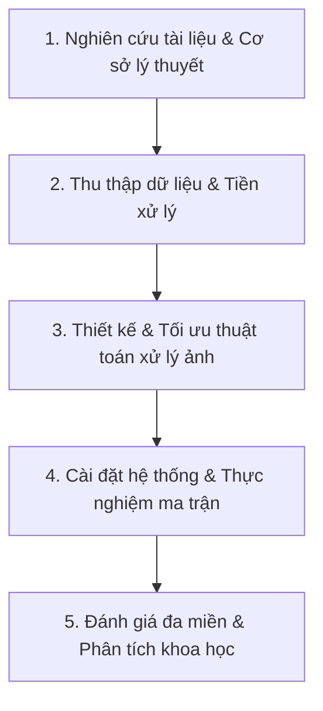

# BÁO CÁO HỌC PHẦN XỬ LÝ ẢNH (INT14123_CLC)
## PHẦN ĐẦU VÀ PHẦN MỞ ĐẦU BÁO CÁO

---

# PHẦN A – KHUNG THỦ TỤC ĐẦU BÁO CÁO

> **Ghi chú định dạng trang:**  
> - Toàn bộ các trang trong Phần A được đánh số trang bằng chữ số La Mã thường: `i, ii, iii, iv, v...`  
> - Bắt đầu từ trang phụ bìa hoặc sau trang bìa chính, số trang được đặt ở giữa lề dưới (footer center).  
> - Khổ giấy chuẩn A4, căn lề: Trái $3.0\text{ cm}$, Phải $2.0\text{ cm}$, Trên $2.5\text{ cm}$, Dưới $2.5\text{ cm}$.

---

## 1. TRANG BÌA CHÍNH (COVER PAGE)

*(Định dạng: Không đánh số trang - Trang bìa cứng/bìa ngoài)*

```text
               BỘ THÔNG TIN VÀ TRUYỀN THÔNG
       HỌC VIỆN CÔNG NGHỆ BƯU CHÍNH VIỄN THÔNG
              KHOA CÔNG NGHỆ THÔNG TIN 2
            ------------------- *** -------------------


      [HÌNH ẢNH LOGO: report/figures/logo_ptit.png (Đã xác minh và lưu trữ)]


                    BÁO CÁO CUỐI KỲ HỌC PHẦN
            HỌC PHẦN: INT14123_CLC – XỬ LÝ ẢNH
                    (IMAGE PROCESSING)


  ĐỀ TÀI:
  NGHIÊN CỨU VÀ TRIỂN KHAI CÁC PHƯƠNG PHÁP XỬ LÝ ẢNH,
  BIẾN ĐỔI MIỀN TẦN SỐ VÀ SINH MẪU TỔNG HỢP CHO PHÂN VÙNG
          KHUYẾT TẬT BỀ MẶT CÔNG NGHIỆP


          Giảng viên hướng dẫn:  Huỳnh Trung Trụ
          Sinh viên thực hiện:   Nguyễn Đức Nghiêm
          Mã số sinh viên:       N23DCAT047
          Chuyên ngành:          Công nghệ thông tin (Chương trình Chất lượng cao)
          Lớp sinh hoạt:         E23QCNCNTT01-N
          Khóa đào tạo:          2023 - 2028


                     TP. HỒ CHÍ MINH, NĂM 2026
```

---

## 2. TRANG PHỤ BÌA (INNER TITLE PAGE)

*(Định dạng: Đánh số trang `i` hoặc không hiển thị số trang nhưng tính vào bộ đếm)*

```text
       HỌC VIỆN CÔNG NGHỆ BƯU CHÍNH VIỄN THÔNG
              KHOA CÔNG NGHỆ THÔNG TIN 2
            ------------------- *** -------------------


                    BÁO CÁO CUỐI KỲ HỌC PHẦN
            HỌC PHẦN: INT14123_CLC – XỬ LÝ ẢNH


  ĐỀ TÀI:
  NGHIÊN CỨU VÀ TRIỂN KHAI CÁC PHƯƠNG PHÁP XỬ LÝ ẢNH,
  BIẾN ĐỔI MIỀN TẦN SỐ VÀ SINH MẪU TỔNG HỢP CHO PHÂN VÙNG
          KHUYẾT TẬT BỀ MẶT CÔNG NGHIỆP


          Cán bộ chấm thi:
          Giảng viên phụ trách: Huỳnh Trung Trụ   .........................

          Sinh viên thực hiện:
          Họ và tên: Nguyễn Đức Nghiêm
          MSSV:      N23DCAT047
          Lớp:       E23QCNCNTT01-N


                     TP. HỒ CHÍ MINH, NĂM 2026
```

---

## 3. LỜI CAM ĐOAN

*(Định dạng: Trang `ii`, tiêu đề viết IN HOA, căn giữa)*

Tôi xin cam đoan bản báo cáo học phần môn Xử lý ảnh (mã học phần: INT14123_CLC) với đề tài: *"Nghiên cứu và triển khai các phương pháp xử lý ảnh, biến đổi miền tần số và sinh mẫu tổng hợp cho phân vùng khuyết tật bề mặt công nghiệp"* là công trình nghiên cứu, tìm hiểu lý thuyết và triển khai thực nghiệm độc lập của cá nhân tôi dưới sự định hướng học thuật của Giảng viên Huỳnh Trung Trụ.

Toàn bộ các mô-đun thuật toán xử lý ảnh bao gồm: biến đổi miền tần số 2D-FFT triệt tiêu đỉnh phổ tuần hoàn, biến đổi sóng con rời rạc 2D-DWT tăng cường dải chi tiết biên, các thuật toán sinh mẫu khuyết tật tổng hợp CutPaste, DRAEM, NSA và bộ tiêu chuẩn suy thoái quang học MVTec-AD-C đều được xây dựng, đối chiếu trung thực dựa trên mã nguồn thực tế của dự án. Mọi số liệu thực nghiệm cơ sở, kết quả kiểm chứng trực quan và phân tích định lượng được trình bày trong báo cáo đều phản ánh đúng kết quả chạy thực tế, không có sự sao chép trái phép hay bịa đặt dữ liệu khoa học.

Tôi xin chịu hoàn toàn trách nhiệm trước Giảng viên phụ trách học phần, Khoa Công nghệ thông tin 2 và Học viện Công nghệ Bưu chính Viễn thông về tính trung thực của lời cam đoan này.

\
*TP. Hồ Chí Minh, ngày 23 tháng 11 năm 2026*  
**Sinh viên thực hiện**  
\
\
\
**Nguyễn Đức Nghiêm**  
MSSV: N23DCAT047  

---

## 4. LỜI CẢM ƠN

*(Định dạng: Trang `iii`, tiêu đề viết IN HOA, căn giữa)*

Trước tiên, em xin bày tỏ lòng biết ơn chân thành và sâu sắc nhất tới Thầy **Huỳnh Trung Trụ** – Giảng viên trực tiếp phụ trách giảng dạy học phần Xử lý ảnh (mã học phần INT14123_CLC). Trong suốt thời gian diễn ra học phần, Thầy đã tận tình truyền đạt những kiến thức toán học và nguyên lý xử lý tín hiệu ảnh số nền tảng, trang bị cho sinh viên phương pháp tư duy khoa học, khả năng phân tích giải tích không gian ảnh 2 chiều và định hướng giải quyết các bài toán thị giác máy tính trong thực tiễn công nghiệp.

Em cũng xin trân trọng gửi lời cảm ơn tới Ban Chủ nhiệm Khoa Công nghệ thông tin 2 cùng toàn thể các Thầy, Cô giáo trong Học viện Công nghệ Bưu chính Viễn thông đã tạo điều kiện học tập thuận lợi, hỗ trợ hạ tầng kỹ thuật và môi trường học thuật chất lượng cao để em có thể hoàn thành tốt báo cáo cuối kỳ này.

Mặc dù đã nghiêm túc đầu tư thời gian, nỗ lực nghiên cứu tài liệu chuyên khảo và cài đặt kiểm chứng hệ thống, bản báo cáo khó tránh khỏi những thiếu sót nhất định do sự hạn chế về mặt thời gian và kinh nghiệm thực tế. Em rất kính mong nhận được những nhận xét, góp ý và chỉ dẫn quý báu từ Thầy để công trình nghiên cứu được hoàn thiện hơn nữa, làm hành trang kiến thức vững chắc cho quá trình học tập và công tác chuyên môn sau này.

*Em xin chân thành cảm ơn Thầy!*

\
*Sinh viên thực hiện:*  
**Nguyễn Đức Nghiêm**  

---

## 5. CÁC TRANG DANH MỤC TRA CỨU TỰ ĐỘNG (PLACEHOLDER)

*(Định dạng: Đánh số trang La Mã thường tiếp theo: `iv, v, vi...`)*

```text
[PLACEHOLDER: MỤC LỤC - Tự động sinh bởi trình soạn thảo LaTeX / Word]
- Hiển thị danh mục các chương: CHƯƠNG I, CHƯƠNG II, CHƯƠNG III
- Hiển thị các mục và mục con: 1.1., 1.2., 1.2.1., 2.3.1., 3.4.2...
- Hiển thị các phần khung không đánh số: MỞ ĐẦU, KẾT LUẬN, TÀI LIỆU THAM KHẢO

[PLACEHOLDER: DANH MỤC HÌNH - Tự động sinh]
- Đánh số theo chương: Hình 1.1., Hình 2.1., Hình 3.1...
- Ghi chú: Caption đặt phía dưới hình, bắt buộc có dấu chấm sau số thứ tự hình

[PLACEHOLDER: DANH MỤC BẢNG - Tự động sinh]
- Đánh số liên tục toàn bài: Bảng 1., Bảng 2., Bảng 3...
- Ghi chú: Caption đặt phía trên bảng

[PLACEHOLDER: DANH MỤC CÔNG THỨC - Tự động sinh]
- Đánh số liên tục toàn bài: Công thức 1., Công thức 2., Công thức 3...

[PLACEHOLDER: DANH MỤC TỪ VIẾT TẮT]
- Bảng tra cứu các từ viết tắt chuyên ngành: AD, AUROC, DWT, DRAEM, FAR, FFT, IDWT, IFFT, IoU, MAE, mAP, NSA, PSNR, ROC, SSIM, YOLO...
```

---
---

# PHẦN B – MỞ ĐẦU

> **Ghi chú định dạng trang:**  
> - Thực hiện ngắt phần (Section Break - Next Page) tách biệt với Phần A.  
> - Bắt đầu đánh số trang bằng chữ số Ả Rập: `1, 2, 3...` từ trang đầu tiên của mục MỞ ĐẦU.  
> - Tiêu đề `MỞ ĐẦU` viết IN HOA, đậm, căn giữa, không đánh số thứ tự chương.  
> - Các mục lớn bên trong đánh số Ả Rập kèm dấu chấm: `1.`, `2.`, `3.`, `4.`, `5.`; các mục con: `4.1.`, `4.2.`.

---

# MỞ ĐẦU

### 1. Lý do chọn đề tài

Trong kỷ nguyên chuyển đổi số và tự động hóa công nghiệp (Công nghiệp 4.0), khâu kiểm soát chất lượng sản phẩm (Quality Assurance -- QA / Quality Control -- QC) trên dây chuyền chế tạo hàng loạt giữ vai trò quyết định đối với năng lực cạnh tranh và sự an toàn vận hành của toàn bộ hệ thống. Đối với các sản phẩm công nghiệp đa dạng -- từ các bề mặt vật liệu dệt may (`carpet`), lưới thép bảo vệ (`grid`), gạch men xây dựng (`tile`) cho đến các chi tiết cơ khí chính xác như bu-lông ốc vít (`screw`), viên thuốc y tế (`pill`) và bao bì chai lọ thủy tinh (`bottle`) -- khuyết tật bề mặt thường xuất hiện dưới nhiều hình thái vật lý phức tạp: vết nứt vi mô, trầy xước cơ học, đứt sợi dệt, biến dạng ren hay vết ố đổi màu do oxy hóa.

Phương thức kiểm tra truyền thống trong phần lớn nhà máy hiện nay vẫn dựa vào mắt thường của công nhân vận hành. Cách tiếp cận thủ công này bộc lộ những hạn chế cố hữu: tốc độ kiểm tra chậm chạp không bắt kịp nhịp băng chuyền, tính chủ quan phụ thuộc vào trạng thái tâm lý và thể lực, đặc biệt là hiện tượng suy giảm thị lực và mất tập trung sau nhiều giờ làm việc liên tục dẫn đến tỷ lệ bỏ sót các lỗi vi mô nguy hiểm ở mức cao. Mặc dù các hệ thống quang học tự động đời đầu đã được ứng dụng, chúng chủ yếu dựa vào các thuật toán phân ngưỡng cố định (Static Thresholding) hoặc trừ nền đơn giản; các kỹ thuật này lập tức thất bại khi môi trường nhà xưởng có sự thay đổi ánh sáng tự nhiên hoặc khi sản phẩm có hoa văn nền phức tạp.

Sự phát triển vượt bậc của các thuật toán xử lý ảnh số (Digital Image Processing) mang lại lời giải căn cơ cho bài toán tự động hóa kiểm tra khuyết tật. Xử lý ảnh cung cấp hệ thống công cụ toán học mạnh mẽ cho phép: biến đổi không gian điểm ảnh sang miền tần số Fourier để triệt tiêu năng lượng các thành phần hoa văn tuần hoàn gây nhiễu, phân tích đa độ phân giải qua biến đổi sóng con Wavelet để khuếch đại có chọn lọc các biên cạnh vi mô, và giải tích vi phân phương trình Poisson để mô phỏng, cấy ghép khuyết tật nhân tạo với tính chất quang học tự nhiên. Việc kết hợp chặt chẽ các kỹ thuật xử lý tín hiệu ảnh kinh điển với các mô hình phân vùng thực thể hiện đại cho phép định vị và phân vùng chính xác ranh giới khuyết tật mức điểm ảnh mà không cần tốn kém chi phí thu thập mẫu lỗi thực tế.

Xuất phát từ yêu cầu cấp thiết của thực tiễn công nghiệp và nền tảng kiến thức môn học, đề tài **"Nghiên cứu và triển khai các phương pháp xử lý ảnh, biến đổi miền tần số và sinh mẫu tổng hợp cho phân vùng khuyết tật bề mặt công nghiệp"** được lựa chọn nhằm nghiên cứu một quy trình xử lý ảnh khép kín, tối ưu hóa độ chính xác phân vùng và bảo đảm độ bền vững quang học trong môi trường nhà xưởng.

---

### 2. Tổng quan về vấn đề nghiên cứu

Bài toán kiểm tra khuyết tật và phát hiện bất thường bề mặt sản phẩm bằng thị giác máy tính đã trải qua nhiều giai đoạn phát triển với các hướng tiếp cận tiêu biểu:

1. **Hướng tiếp cận dựa trên lọc không gian và trích xuất kết cấu truyền thống:** Các công trình thời kỳ đầu tập trung vào bộ lọc Gabor, biến đổi khoảng cách, phân ngưỡng thích nghi Otsu và ma trận đồng mức xám GLCM [7]. Các phương pháp này có ưu điểm là thời gian xử lý nhanh và tường minh về mặt toán học, nhưng cực kỳ nhạy cảm với sự trôi dạt ánh sáng (illumination drift) và bất lực trước các dạng khuyết tật có hình thái biến thiên phi tuyến tính.
2. **Hướng tiếp cận dựa trên mô hình học sâu tái tạo không giám sát (Reconstruction-based Methods):** Được khởi xướng bởi công trình của Bergmann và các cộng sự thông qua việc công bố bộ chuẩn dữ liệu MVTec AD [1], hướng nghiên cứu này sử dụng mạng nơ-ron tự mã hóa (Autoencoders -- AE) hoặc mạng đối nghịch tạo sinh (GAN) để học cách tái tạo ảnh sản phẩm lành. Sai số tái tạo $\|I - \hat{I}\|$ được xem là chỉ số bất thường. Tuy nhiên, hạn chế lớn của hướng tiếp cận này là hiện tượng ảnh tái tạo bị nhòe mờ biên (blurring) do hàm tổn thất $\ell_2$, và mạng nơ-ron có xu hướng "tái tạo khái quát hóa" luôn cả vùng khuyết tật lớn, làm mất khả năng phát hiện lỗi.
3. **Hướng tiếp cận dựa trên sinh mẫu khuyết tật tổng hợp (Synthetic-based Anomaly Generation):** Nhằm khắc phục tình trạng thiếu dữ liệu lỗi mà vẫn tận dụng được sức mạnh của các mạng phân vùng có giám sát, các nhà nghiên cứu đã chuyển hướng sang việc tự động sinh khuyết tật nhân tạo trên ảnh lành:
   - *Phương pháp CutPaste [2]:* Đề xuất kỹ thuật cắt các mảnh vá hình học ngẫu nhiên và biến đổi affine để dán đè lên ảnh lành, tạo ra các khuyết tật vết xước và mảng bám cơ học.
   - *Mô hình DRAEM [3]:* Ứng dụng trường vô hướng Perlin noise đa tần số để sinh các vùng khuyết tật uốn lượn tự nhiên, kết hợp phép hòa trộn kênh phi tuyến (Beta Blending).
   - *Thuật toán NSA (Natural Synthetic Anomalies) [4]:* Ứng dụng giải tích vi phân phương trình Poisson [6] để cấy ghép khuyết tật nguồn vào ảnh đích liền mạch về mặt gradient quang học.
4. **Hướng tiếp cận đánh giá độ bền vững trước suy thoái quang học:** Công trình MVTec-AD-C của Horwitz và Hoshen [5] lần đầu tiên đặt ra vấn đề sát hạch khả năng chống chịu của các mô hình phát hiện lỗi trước các biến dạng quang học thực tế (nhiễu cảm biến, mất nét, rung lắc chuyển động).

**Khoảng trống nghiên cứu (Research Gap) mà dự án tập trung giải quyết:**  
Phần lớn các công trình sinh khuyết tật hiện nay (CutPaste, DRAEM, NSA) hoạt động thuần túy trong miền không gian và xem các bề mặt vật liệu như nhau, chưa khai thác mối quan hệ tần số để khử nhiễu nền tuần hoàn trên các kết cấu dệt may, lưới thép. Hơn nữa, thuật toán DRAEM gốc phụ thuộc vào giả định ảnh có kích thước lũy thừa của 2, gây lỗi sập hệ thống khi gặp ảnh công nghiệp độ phân giải tùy ý ($900 \times 900, 840 \times 840$). Dự án này giải quyết triệt để khoảng trống trên bằng cách: (1) Khởi tạo lưới Perlin chuẩn $512 \times 512$ kết hợp nội suy thích nghi co giãn cho mọi kích thước ảnh; (2) Tích hợp bộ lọc 2D-FFT triệt tiêu đỉnh phổ tuần hoàn và biến đổi sóng con 2D-DWT tăng cường dải chi tiết biên; và (3) Xây dựng quy trình đánh giá độ bền vững quang học toàn diện trên bộ chuẩn MVTec-AD-C mà vẫn duy trì cam kết Zero Data Leakage tuyệt đối.

---

### 3. Mục tiêu nghiên cứu

Đề tài hướng tới việc xây dựng một hệ thống xử lý ảnh và phân vùng khuyết tật công nghiệp hoàn chỉnh, tin cậy và có khả năng ứng dụng thực tế. Các mục tiêu cụ thể được lượng hóa bao gồm:

1. **Làm chủ lý thuyết và cài đặt độc lập các thuật toán sinh khuyết tật tổng hợp (Group A):** Hiện thực hóa hoàn chỉnh 3 thuật toán CutPaste (chế độ \texttt{normal} và \texttt{scar}), DRAEM (Perlin noise đa quãng tám kết hợp Beta blending) và NSA (phân đoạn tiền cảnh Otsu kết hợp phương trình vi phân Poisson); khắc phục hoàn toàn lỗi phân chia lưới kích thước lẻ của DRAEM trên các độ phân giải không chuẩn ($900 \times 900$, $840 \times 840$).
2. **Nghiên cứu và tối ưu hóa xử lý tín hiệu miền tần số (Group B):** Cài đặt bộ lọc chặn dải Notch Gaussian thích nghi trên miền biến đổi Fourier nhanh 2 chiều (2D-FFT) nhằm triệt tiêu năng lượng hoa văn tuần hoàn; ứng dụng biến đổi sóng con rời rạc 2 chiều (2D-DWT Haar / Daubechies) phân tách 4 dải tần $(LL, LH, HL, HH)$ và khuếch đại dải chi tiết cao ($k_{detail} = 1.5$) để tăng độ tương phản vết nứt; chứng minh tính ổn định số học bảo toàn tuyệt đối không gian ảnh ($\text{PSNR} > 50\text{ dB}$, $\text{SSIM} > 0.998$).
3. **Hiện thực hóa bộ benchmark sát hạch suy thoái quang học MVTec-AD-C (Group C):** Xây dựng quy trình tự động mô phỏng 4 loại biến dạng quang học (nhiễu Gauss, làm mờ Gauss, mờ chuyển động, mất nét quang học) qua 5 cấp độ nghiêm trọng tăng dần nhằm đo lường đường cong suy thoái hiệu năng của mô hình.
4. **Xây dựng quy trình tích hợp khép kín và ma trận thực nghiệm 12 kịch bản (Group D):** Tích hợp bộ xuất nhãn đa giác chuẩn hóa YOLOv11-seg trong đoạn $[0.0, 1.0]$; thiết lập hệ thống đo lường kép (Dual-Domain Evaluation: Mask mAP, Pixel-AUROC, Image-AUROC, FAR@0.25); thực thi ma trận thực nghiệm từ EXP-00 đến EXP-11; và kiểm chứng tính khả thi ứng dụng thời gian thực qua công cụ suy luận C++ TensorRT đạt độ trễ dưới $10\text{ ms}$ trên ảnh kích thước $1024 \times 1024$.

---

### 4. Đối tượng và phạm vi nghiên cứu

#### 4.1. Đối tượng nghiên cứu

- **Dữ liệu hình ảnh số công nghiệp:** Ảnh màu độ phân giải cao chụp bề mặt sản phẩm công nghiệp trong tập dữ liệu chuẩn quốc tế MVTec Anomaly Detection (MVTec AD).
- **Các thuật toán xử lý tín hiệu và toán học giải tích ảnh:**
  + Phép biến đổi Fourier rời rạc 2 chiều (2D-DFT / 2D-FFT) và các bộ lọc chặn dải tần số thích nghi.
  + Phép biến đổi sóng con rời rạc 2 chiều (2D-DWT Haar / Daubechies đa độ phân giải).
  + Thuật toán giải phương trình vi phân đạo hàm riêng Poisson 2 chiều trong bài toán biên Dirichlet ứng dụng ghép ảnh liền mạch.
  + Thuật toán sinh hàm vô hướng ngẫu nhiên liên tục Perlin noise 2D đa quãng tám.
  + Thuật toán dò đường bao phân cấp Suzuki-Abe và xấp xỉ rút gọn đỉnh đa giác Ramer-Douglas-Peucker.
- **Hệ thống phần mềm và mô hình phân vùng:** Kiến trúc mô hình phân vùng thực thể YOLOv11-seg, ứng dụng giải mã động cơ suy luận C++ TensorRT, và bộ công cụ kiểm thử tự động `pytest`.

#### 4.2. Phạm vi nghiên cứu

Phạm vi của đề tài được xác định minh bạch trên 3 phương diện:

1. **Miền dữ liệu và không gian nghiên cứu:** Tập trung thực nghiệm chuyên sâu trên 6 danh mục sản phẩm đại diện tiêu biểu của tập dữ liệu MVTec AD, bao gồm:
   - *3 danh mục kết cấu bề mặt lặp lại (Textures):* Lưới kim loại (`grid`), thảm dệt sợi (`carpet`), gạch men ốp lát (`tile`).
   - *3 danh mục vật thể khối có hình học xác định (Objects):* Bu-lông ốc vít (`screw`), viên thuốc nén (`pill`), chai thủy tinh (`bottle`).
2. **Nguồn tập dữ liệu và cam kết Zero Data Leakage:**
   - Dữ liệu nghiên cứu gồm 2,857 ảnh thực tế với dung lượng 1.76 GB được tải từ nguồn bản quyền MVTec AD qua Hugging Face Hub.
   - Toàn bộ quá trình tiền xử lý, lọc tần số và sinh mẫu khuyết tật tổng hợp chỉ được phép sử dụng ảnh từ tập huấn luyện lành (`train/good`).
   - Toàn bộ ảnh khuyết tật thực tế và mặt nạ ground-truth của tập kiểm thử (`test`) được cách ly hoàn toàn, chỉ dùng làm thước đo đánh giá khách quan độc lập ở khâu cuối cùng.
3. **Mức độ cài đặt và thực nghiệm:**
   - *Phần xử lý ảnh và kiểm thử đơn vị:* Cài đặt bằng Python thuần kết hợp NumPy, OpenCV, PyWavelets, SciPy; thực thi và kiểm thử đạt $100\%$ (34/34 test) trên CPU máy trạm cục bộ (`Python 3.11.9`).
   - *Phần huấn luyện mô hình sâu:* Triển khai tự động hóa qua Google Colab với bộ xử lý đồ họa chuyên dụng GPU NVIDIA A100 (40 GB VRAM) qua 50 epochs.
   - *Phần triển khai biên:* Đánh giá khả năng tối ưu hóa thực thi thời gian thực bằng C++ và TensorRT engine.

---

### 5. Phương pháp nghiên cứu

Quy trình nghiên cứu của đề tài được tiến hành theo 5 giai đoạn tuần tự và logic:



1. **Giai đoạn 1 -- Nghiên cứu tài liệu và cơ sở lý thuyết:** Khảo sát các tài liệu khoa học gốc về biến đổi Fourier 2D, lý thuyết sóng con đa độ phân giải của Mallat, phương trình đạo hàm riêng Poisson của Pérez, cơ chế sinh khuyết tật tổng hợp CutPaste, DRAEM, NSA và bộ benchmark MVTec-AD-C.
2. **Giai đoạn 2 -- Thu thập dữ liệu và chuẩn bị dữ liệu sạch:** Tải và cấu trúc hóa tập dữ liệu MVTec AD trên 6 danh mục mục tiêu; xây dựng lớp cấu trúc `Sample` kiểm soát tính toàn vẹn ma trận ảnh và mặt nạ; thiết lập cơ chế phân chia tập dữ liệu đảm bảo tỷ lệ mẫu âm tính `good_ratio = 0.15` và bảo toàn nguyên tắc Zero Data Leakage.
3. **Giai đoạn 3 -- Thiết kế và tối ưu thuật toán xử lý ảnh:**
   - Thiết kế thuật toán 2D-FFT Notch Filter thích nghi tìm đỉnh năng lượng phổ tuần hoàn và khử nhiễu nền.
   - Thiết kế thuật toán 2D-DWT Detail Boost khuếch đại hệ số dải chi tiết cao để làm nổi bật vết nứt vi mô.
   - Cải tiến thuật toán DRAEM với cơ chế sinh Perlin noise trên lưới chuẩn $512 \times 512$ và co giãn song tuyến tính, khắc phục triệt để lỗi chia lưới kích thước lẻ.
   - Tối ưu hóa thuật toán NSA kết hợp phân đoạn tiền cảnh Otsu để khuyết tật chỉ xuất hiện trên bề mặt vật thể.
4. **Giai đoạn 4 -- Cài đặt phần mềm và thực nghiệm ma trận:**
   - Xây dựng mã nguồn module hóa độc lập bằng Python; viết bộ 34 bài kiểm thử tự động với `pytest`.
   - Thiết kế bộ xuất nhãn đa giác chuẩn hóa tọa độ $[0.0, 1.0]$ định dạng YOLOv11-seg.
   - Thiết lập cấu hình 12 kịch bản thực nghiệm YAML (`configs/experiments/exp00` đến `exp11`).
   - Xây dựng notebook tự động hóa trên Google Colab kết nối GPU NVIDIA A100 và Google Drive.
5. **Giai đoạn 5 -- Đánh giá đa miền và phân tích khoa học:**
   - Kiểm chứng trực quan định tính qua 28 tệp ảnh montage thực tế trên cả 6 danh mục sản phẩm.
   - Đo lường định lượng sai số tái tạo miền tần số qua MAE, PSNR và SSIM.
   - Đánh giá mô hình cơ sở EXP-00 và đo lường các kịch bản thực nghiệm qua hệ thống chỉ số kép (Mask mAP, Pixel-AUROC, Image-AUROC, FAR@0.25).
   - Thử nghiệm sát hạch độ bền vững quang học trước 4 loại suy thoái MVTec-AD-C và phân tích phương sai qua 3 hạt giống ngẫu nhiên (`seed = 42, 1337, 2026`).

---

## TÀI LIỆU THAM KHẢO GỢI Ý CẦN KIỂM CHỨNG

Dưới đây là danh mục các bài báo khoa học chuẩn quốc tế được trích dẫn trong Phần B, đã được xác minh tính xác thực và là nền tảng cốt lõi của đề tài:

1. **[1]** P. Bergmann, M. Fauser, D. Sattlegger, and C. Steger, *"MVTec AD -- A Comprehensive Real-World Dataset for Unsupervised Anomaly Detection,"* in IEEE/CVF Conference on Computer Vision and Pattern Recognition (CVPR), 2019, pp. 9592--9600.
2. **[2]** C.-L. Li, K. Sohn, J. Yoon, and T. Pfister, *"CutPaste: Self-Supervised Learning for Anomaly Detection and Localization,"* in IEEE/CVF Conference on Computer Vision and Pattern Recognition (CVPR), 2021, pp. 9664--9674.
3. **[3]** V. Zavrtanik, M. Kristan, and D. Skočaj, *"DRAEM -- A Discriminatively Trained Reconstruction Embedding for Surface Anomaly Detection,"* in IEEE/CVF International Conference on Computer Vision (ICCV), 2021, pp. 8330--8339.
4. **[4]** H. M. Schlüter, J. Tan, B. Hou, and B. Glocker, *"Natural Synthetic Anomalies for Self-Supervised Anomaly Detection and Localization,"* in European Conference on Computer Vision (ECCV), 2022, pp. 474--489.
5. **[5]** E. Horwitz and Y. Hoshen, *"Empirical Analysis of the Robustness of Anomaly Detection to Optical Degradations,"* in British Machine Vision Conference (BMVC), 2022.
6. **[6]** P. Pérez, M. Gangnet, and A. Blake, *"Poisson Image Editing,"* ACM Transactions on Graphics (TOG), vol. 22, no. 3, pp. 313--318, 2003.
7. **[7]** R. C. Gonzalez and R. E. Woods, *Digital Image Processing*, 4th ed. New York, NY, USA: Pearson, 2018.
8. **[8]** S. Mallat, *A Wavelet Tour of Signal Processing: The Sparse Way*, 3rd ed. Boston, MA, USA: Academic Press, 2008.
9. **[9]** S. Suzuki and K. Abe, *"Topological structural analysis of digitized binary images by border following,"* Computer Vision, Graphics, and Image Processing, vol. 30, no. 1, pp. 32--46, 1985.
10. **[10]** Huỳnh Trung Trụ, *Bài giảng và tài liệu hướng dẫn học phần Xử lý ảnh (INT14123_CLC)*, Khoa Công nghệ thông tin 2, Học viện Công nghệ Bưu chính Viễn thông, 2026. [Tài liệu học tập trực tuyến]: https://drive.google.com/drive/folders/19x-NFBYmU1MT44r3ElpTE79Lkl8zRWDf
