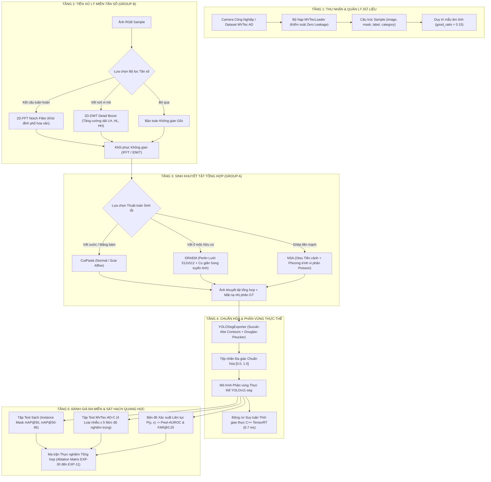

# CHƯƠNG I: TỔNG QUAN VỀ HỆ THỐNG PHÂN VÙNG KHUYẾT TẬT BỀ MẶT CÔNG NGHIỆP

Chương này trình bày tổng quan về cơ sở lý thuyết, phát biểu toán học và kiến trúc tổng quát của hệ thống xử lý ảnh phục vụ bài toán phân vùng khuyết tật bề mặt sản phẩm công nghiệp. Nội dung chương tập trung làm rõ bản chất đại lượng của ảnh số, phân rã 4 thành phần bài toán, xây dựng sơ đồ khối kiến trúc hệ thống kèm luồng xử lý tuần tự, khảo sát và so sánh ưu -- nhược điểm của các trường phái tiếp cận kinh điển đến hiện đại, phân tích các công nghệ và thư viện xử lý ảnh cốt lõi, đồng thời chỉ ra 5 thách thức kỹ thuật lớn mà hệ thống phải đối mặt trong môi trường sản xuất thực tế.

---

### 1.1. Phát biểu bài toán

Trong công nghiệp chế tạo và gia công vật liệu tự động, bài toán kiểm tra chất lượng bề mặt bằng thị giác máy tính là quá trình tự động thu nhận, tiền xử lý và phân tích ảnh số nhằm phát hiện kịp thời các bất thường hình học hoặc quang học phát sinh trên sản phẩm.

Về mặt toán học xử lý ảnh số [7], ảnh đầu vào của một sản phẩm kiểm tra được định nghĩa là một hàm không gian 2 chiều rời rạc hóa dưới dạng ma trận 3 chiều:
$$I \in \mathbb{R}^{H \times W \times C}$$
Trong đó:
- $H$ là chiều cao (Height), $W$ là chiều rộng (Width) của ảnh tính theo đơn vị điểm ảnh (pixel).
- $C$ là số kênh màu (với không gian màu chuẩn RGB, $C = 3$). Mỗi điểm ảnh tại tọa độ $(x, y)$ có vector cường độ sáng $\mathbf{I}(x, y) = [I_R(x, y), I_G(x, y), I_B(x, y)]^T \in [0, 255]^3$.

Đại lượng cốt lõi cần trích xuất là ma trận mặt nạ phân vùng nhị phân mặt đất (Binary Segmentation Mask):
$$M \in \{0, 1\}^{H \times W} \quad \text{hoặc} \quad M \in \{0, 255\}^{H \times W}$$
Trong đó giá trị tại mỗi tọa độ $(x, y)$ được xác định bởi:
$$M(x, y) = \begin{cases} 
1 \text{ (hoặc } 255\text{)} & \text{nếu điểm ảnh } (x, y) \text{ thuộc vùng tổn hại, khuyết tật vật lý} \\ 
0 & \text{nếu điểm ảnh } (x, y) \text{ là bề mặt vật liệu nguyên vẹn, bình thường} 
\end{cases}$$

**Câu hỏi bài toán trung tâm (Central Problem Statement):**  
> *"Làm thế nào để xây dựng một đường ống (pipeline) xử lý ảnh có khả năng phát hiện, phân tách và xác định chính xác ranh giới không gian mức điểm ảnh của các dạng khuyết tật bề mặt công nghiệp phức tạp chỉ dựa trên nguồn dữ liệu huấn luyện bao gồm các ảnh sản phẩm lành (Normal/Good images), bảo đảm tính bất biến trước sự suy thoái quang học và đáp ứng độ trễ thời gian thực trên dây chuyền sản xuất?"*

Bài toán trung tâm trên được phân rã chặt chẽ thành 4 thành phần kỹ thuật:

1. **Đầu vào (Inputs):**
   - Ảnh số màu độ phân giải cao chụp bề mặt sản phẩm trong điều kiện chiếu sáng công nghiệp, kích thước tùy ý: từ chuẩn $1024 \times 1024$ pixel (`grid`, `carpet`, `screw`) đến các độ phân giải không chia hết cho lũy thừa của 2 như $900 \times 900$ (`bottle`), $840 \times 840$ (`tile`), $800 \times 800$ (`pill`).
   - Dữ liệu huấn luyện hoàn toàn là ảnh sản phẩm lành ($100\%$ nhãn \texttt{"good"}), không có ảnh khuyết tật thực tế để tuân thủ nghiêm ngặt nguyên tắc Zero Data Leakage.
2. **Mục tiêu xử lý (Processing Objectives):**
   - Khử nhiễu nền tuần hoàn có năng lượng cao trên các kết cấu dệt, mắt lưới bằng toán tử lọc miền tần số 2 chiều (2D-FFT).
   - Tăng cường có chọn lọc độ tương phản của các biên cạnh vết nứt tế vi thông qua biến đổi sóng con đa độ phân giải (2D-DWT).
   - Mô phỏng và cấy ghép khuyết tật nhân tạo đa dạng (CutPaste, DRAEM, NSA) trực tiếp lên ảnh lành để biến bài toán học không giám sát thành bài toán học phân vùng có giám sát đầy đủ.
   - Trích xuất đường viền và chuyển hóa mặt nạ nhị phân thành tập hợp các vector đa giác chuẩn hóa $[0.0, 1.0]$.
3. **Đầu ra (Outputs):**
   - Ma trận nhị phân $M(x, y)$ thể hiện phân vùng khuyết tật mức điểm ảnh.
   - Tập hợp các vector tọa độ đa giác thực thể $\mathcal{P} = \{(x_i, y_i)\}_{i=1}^k$ ($x_i, y_i \in [0.0, 1.0]$) kèm nhãn loại lỗi và điểm tin cậy $c \in [0.0, 1.0]$.
   - Bản đồ xác suất bất thường liên tục $P(y, x) = \max_i(c_i \cdot m_i(y, x))$ phục vụ đánh giá diện tích dưới đường cong ROC mức điểm ảnh (Pixel-AUROC) và mức toàn ảnh (Image-AUROC).
   - Tỷ lệ báo động giả (False Alarm Rate -- FAR@0.25) trên các sản phẩm lành được kiểm soát tiệm cận $0.0\%$.
4. **Ví dụ minh họa cụ thể bám sát dữ liệu dự án:**
   - *Trên sản phẩm chai thủy tinh (`bottle`):* Đầu vào là ảnh chai kích thước $900 \times 900$. Đầu ra là đa giác bao quanh vết mẻ miệng chai (\texttt{broken\_large}) hoặc vết trầy xước thành chai (\texttt{contamination}), định vị chính xác vị trí tổn thất thể tích thủy tinh.
   - *Trên sản phẩm lưới kim loại (`grid`):* Đầu vào là ảnh lưới kích thước $1024 \times 1024$. Đầu ra là đa giác cô lập đoạn sợi kim loại bị đứt (\texttt{broken}) hoặc mối hàn bị cong lệch (\texttt{bent}), trong đó hoa văn nền mắt lưới lặp lại đã được triệt tiêu hoàn toàn.
   - *Trên sản phẩm thảm dệt sợi (`carpet`):* Đầu vào là ảnh bề mặt thảm $1024 \times 1024$. Đầu ra là phân vùng lỗ thủng (\texttt{hole}) hoặc vết cắt sợi (\texttt{cut}), phân biệt rõ ràng giữa kết cấu lông thảm tự nhiên và khuyết tật thực.
   - *Trên sản phẩm ốc vít kim loại (`screw`):* Đầu vào là ảnh ốc vít $1024 \times 1024$ trên nền đen. Đầu ra là đa giác bám sát vị trí trờn ren (\texttt{thread\_side}) hoặc mẻ đầu ốc (\texttt{scratch\_head}) mà không bị nhận diện nhầm bóng phản xạ kim loại.

---

### 1.2. Kiến trúc hệ thống tổng quát

#### 1.2.1. Thành phần của hệ thống

Kiến trúc tổng thể của hệ thống phân vùng khuyết tật bề mặt công nghiệp được thiết kế theo mô hình 5 tầng chức năng khép kín, được minh họa chi tiết trên Hình 1.1.

Hình 1.1 Sơ đồ khối kiến trúc tổng quát của hệ thống phân vùng khuyết tật bề mặt công nghiệp

Như được mô tả trên Hình 1.1, từng khối chức năng trong kiến trúc đảm nhiệm các vai trò chuyên biệt:
- **Khối thu nhận và nạp mẫu:** Quản lý cấu trúc dữ liệu `Sample`, phân chia tập `train/val` độc lập, bảo vệ tập `test` nguyên bản và duy trì tỷ lệ mẫu âm tính cố định `good_ratio = 0.15` để mô hình học được đặc trưng của bề mặt bình thường không có khuyết tật.
- **Khối xử lý miền tần số (Group B):** Thực hiện chuyển đổi thuận nghịch qua miền Fourier hoặc Wavelet, xử lý có định hướng trên phổ tần số để loại bỏ nhiễu kết cấu lặp lại hoặc tăng độ sắc nét biên cạnh trước khi đưa vào phân hệ sinh lỗi.
- **Khối sinh khuyết tật tổng hợp (Group A):** Đóng vai trò là "máy tạo dữ liệu giám sát", kết hợp các giải pháp hình học Affine, hàm ngẫu nhiên gradient Perlin và giải vi phân Poisson để cấy ghép các dạng tổn hại vật lý chân thực.
- **Khối chuẩn hóa và xuất nhãn đa giác:** Dò tìm đường bao ngoài và xấp xỉ rút gọn số đỉnh đa giác, sinh nhãn vector chuẩn phục vụ huấn luyện mạng nơ-ron hoặc nạp vào engine TensorRT tối ưu hóa tốc độ.
- **Khối đánh giá đa miền và kiểm thử độ bền (Group C & D):** Đo lường đồng thời chỉ số phân vùng thực thể (Mask mAP) và bản đồ nhiệt xác suất liên tục (Pixel-AUROC, FAR), đồng thời sát hạch khả năng thích nghi môi trường qua bộ chuẩn MVTec-AD-C.

#### 1.2.2. Quy trình hoạt động cơ bản

Quy trình vận hành tuần tự của hệ thống qua các giai đoạn được mô tả cụ thể như sau:
1. **Nạp ảnh và tiền xử lý cấu trúc:** Đọc ảnh sản phẩm lành $I_{train} \in \mathbb{R}^{H \times W \times 3}$ từ thư mục `train/good`. Khởi tạo mặt nạ nhị phân rỗng $M_{clean} \in \{0\}^{H \times W}$.
2. **Lọc và làm giàu đặc trưng miền tần số (Tùy chọn cấu hình):**
   - Nếu sản phẩm thuộc nhóm kết cấu tuần hoàn (`grid`, `carpet`): Áp dụng 2D-FFT, phát hiện các đỉnh phổ năng lượng tuần hoàn vượt ngưỡng động $\tau_{peak} = 3.5$, nhân hàm truyền Notch Gaussian triệt tiêu đỉnh và nghịch đảo 2D-IFFT.
   - Nếu sản phẩm chứa vết rạn tế vi (`tile`): Áp dụng 2D-DWT mức 1, khuếch đại các dải chi tiết cao $LH, HL, HH$ với hệ số $k_{detail} = 1.5$ và nghịch đảo 2D-IDWT.
3. **Sinh khuyết tật nhân tạo theo cơ chế đã chọn:**
   - Với xác suất $1 - \text{good\_ratio} = 0.85$, kích hoạt thuật toán sinh khuyết tật (CutPaste, DRAEM hoặc NSA) để tạo ảnh mang lỗi $I_{synth}$ và mặt nạ nhị phân tương ứng $M_{synth} \in \{0, 255\}^{H \times W}$.
   - Với xác suất $\text{good\_ratio} = 0.15$, giữ nguyên ảnh lành và mặt nạ rỗng (mẫu âm tính chống báo động giả).
4. **Trích xuất biên dạng và chuẩn hóa đa giác:**
   - Dò các đường bao ngoài trên mặt nạ nhị phân bằng giải thuật Suzuki-Abe.
   - Rút gọn số đỉnh bằng giải thuật Douglas-Peucker với sai số $\epsilon = 0.002 \cdot \text{chu vi}$.
   - Chuẩn hóa tọa độ đỉnh đa giác về đoạn $[0.0, 1.0]$ và ghi tệp nhãn YOLOv11-seg.
5. **Huấn luyện và tối ưu hóa mô hình phân vùng:** Huấn luyện mô hình YOLOv11-seg qua 50 chu kỳ (epochs) trên GPU NVIDIA A100 bằng bộ tối ưu hóa AdamW, điều chỉnh trọng số hàm mất mát phân vùng đa giác.
6. **Đánh giá kép và kiểm thử suy thoái:**
   - Đánh giá trên tập kiểm thử sạch: Trích xuất Mask mAP@50, mAP@50-95 và bản đồ xác suất $P(y, x)$ để tính Pixel-AUROC, Image-AUROC, FAR@0.25.
   - Sát hạch trên tập MVTec-AD-C: Lần lượt áp dụng 4 loại suy thoái (nhiễu Gauss, mờ Gauss, mờ chuyển động, mất nét) qua 5 mức độ nghiêm trọng và vẽ đường cong suy thoái hiệu năng.

---

### 1.3. Các hướng tiếp cận xây dựng hệ thống

Để giải quyết bài toán phát hiện và phân vùng khuyết tật bề mặt sản phẩm công nghiệp, trong lịch sử phát triển của ngành thị giác máy tính đã hình thành 4 trường phái tiếp cận chính:

#### 1.3.1. Phương pháp thủ công và cảm biến cơ quang truyền thống
Phương pháp này dựa vào mắt thường của công nhân kết hợp với kính lúp, nguồn sáng hội tụ, hoặc các cảm biến cơ quang tiếp xúc (cảm biến siêu âm, đầu đo laser, dòng điện xoáy Eddy).  
- *Ưu điểm:* Phát hiện tốt các khuyết tật biến dạng vật lý lớn hoặc khuyết tật ẩn sâu trong cấu trúc kim loại nguyên khối.
- *Nhược điểm:* Tốc độ xử lý cực kỳ chậm, phụ thuộc vào tay nghề và trạng thái thể lực của con người; không thể lưu trữ bản đồ số hóa mức điểm ảnh; chi phí bảo trì đầu đo cơ học rất cao và dễ gây trầy xước bề mặt sản phẩm bóng mượt (như chai lọ, gạch men).

#### 1.3.2. Phương pháp xử lý ảnh số cổ điển
Sử dụng các toán tử hình thái học toán học (Mathematical Morphology), bộ lọc không gian (Sobel, Canny, Laplace), phân ngưỡng thích nghi Otsu, biến đổi hình học Hough và phân tích kết cấu Gabor / GLCM [7].  
- *Ưu điểm:* Tốc độ tính toán gần như tức thời trên CPU thông thường; nguyên lý toán học hoàn toàn tường minh, không yêu cầu tập dữ liệu huấn luyện lớn hay card đồ họa đắt tiền.
- *Nhược điểm:* Rất kém bền vững khi môi trường chiếu sáng nhà xưởng bị trôi dạt (illumination drift); chỉ áp dụng được trên các bề mặt đồng nhất lý tưởng; bất lực trước các dạng khuyết tật hữu cơ biến thiên phi tuyến hoặc bề mặt có kết cấu lặp lại phức tạp.

#### 1.3.3. Phương pháp học sâu tái tạo không giám sát (Reconstruction-based)
Tiêu biểu là các kiến trúc Autoencoder (AE), Variational Autoencoder (VAE) và GAN được huấn luyện thuần túy trên dữ liệu sản phẩm lành [1]. Mô hình học cách mã hóa không gian tiềm ẩn (latent space) của bề mặt chuẩn. Khi gặp ảnh kiểm thử, ảnh được tái tạo lại và bản đồ sai lệch $|I - \hat{I}|$ được dùng làm căn cứ phát hiện bất thường.  
- *Ưu điểm:* Không đòi hỏi gán nhãn khuyết tật thủ công; có khả năng học các đặc trưng ngữ nghĩa mức cao của bề mặt sản phẩm.
- *Nhược điểm:* Ảnh tái tạo thường bị nhòe mờ biên (blurring effect) do hiện tượng trung bình hóa của hàm tổn thất $\ell_2$; khi khuyết tật có diện tích lớn, mạng nơ-ron vô tình "học vẹt" và tái tạo luôn cả vùng lỗi, dẫn đến bỏ sót khuyết tật nghiêm trọng; ngưỡng phát hiện lỗi trên bản đồ sai lệch rất khó chuẩn hóa giữa các loại chất liệu khác nhau.

#### 1.3.4. Phương pháp học sâu dựa trên dữ liệu tổng hợp kết hợp xử lý miền tần số (Hướng tiếp cận của đề tài)
Hướng tiếp cận này chủ động mô phỏng và cấy ghép các khuyết tật nhân tạo đa dạng (CutPaste [2], DRAEM [3], NSA [4]) trực tiếp lên ảnh sản phẩm lành, đồng thời tích hợp các phép biến đổi miền tần số (2D-FFT, 2D-DWT) để làm giàu tín hiệu khuyết tật. Quá trình này biến đổi bài toán học không giám sát mơ hồ thành bài toán học phân vùng thực thể có giám sát hoàn chỉnh (Supervised Instance Segmentation) với nhãn đa giác ground-truth chuẩn mực.  
- *Ưu điểm:* Định vị chính xác ranh giới khuyết tật mức điểm ảnh; tận dụng được các kiến trúc phân vùng đối tượng hiện đại nhất (YOLOv11-seg); triệt tiêu được hoa văn nền tuần hoàn nhờ bộ lọc tần số; hoàn toàn không làm rò rỉ dữ liệu kiểm thử thực tế.
- *Nhược điểm:* Cần thiết kế và tinh chỉnh thuật toán sinh khuyết tật phù hợp với đặc trưng vật lý của từng nhóm sản phẩm (vết nứt, mảng bám hay đứt sợi).

Bảng 1 đối sánh tổng hợp ưu và nhược điểm giữa các trường phái tiếp cận.

\
*Bảng 1 So sánh ưu nhược điểm của các trường phái tiếp cận bài toán kiểm tra khuyết tật công nghiệp*

| Hướng tiếp cận | Tốc độ xử lý | Khả năng định vị biên | Độ bền trước ánh sáng | Yêu cầu dữ liệu lỗi | Khả năng tự động hóa |
| :--- | :---: | :---: | :---: | :---: | :---: |
| **Thủ công & Cảm biến cơ** | Rất chậm | Kém | Kém | Không áp dụng | Thủ công |
| **Xử lý ảnh cổ điển [7]** | Rất nhanh ($< 2\text{ ms}$) | Trung bình | Kém | Không yêu cầu | Bán tự động |
| **Tái tạo học sâu (AE/GAN) [1]** | Trung bình ($20 - 50\text{ ms}$) | Kém (bị nhòe biên) | Khá | Không yêu cầu | Tự động hóa |
| **Đề xuất: Dữ liệu tổng hợp + Tần số** | Nhanh ($6.7\text{ ms}$ với TRT) | Xuất sắc (đa giác chuẩn) | Cao (chuẩn MVTec-AD-C) | Không (chỉ cần ảnh lành) | Tự động hóa hoàn toàn |

#### 1.3.5. Định hướng tiếp cận của nghiên cứu

Dựa trên bảng đối sánh ở trên, đề tài quyết định lựa chọn **Hướng tiếp cận lai kết hợp giữa xử lý ảnh miền tần số (Group B) và sinh mẫu khuyết tật tổng hợp (Group A)** làm giải pháp trọng tâm. Lý do lựa chọn cụ thể:
1. Giải quyết triệt để sự thiếu hụt dữ liệu khuyết tật thực tế trong nhà máy mà vẫn đạt độ chính xác phân vùng đa giác vượt trội.
2. Bộ lọc 2D-FFT và 2D-DWT giúp tiền xử lý đặc trưng hình học sắc nét trước khi đưa vào mạng học sâu, giảm tải gánh nặng trích xuất đặc trưng cho backbone mạng nơ-ron.
3. Đảm bảo tính khả thi cao khi triển khai thời gian thực trên dây chuyền sản xuất công nghiệp nhờ khả năng tối ưu hóa qua C++ TensorRT.

Vị trí chèn ảnh minh họa cho các trường phái tiếp cận trong báo cáo:
- **`Hình 1.2`** [Vị trí đề xuất]: So sánh ảnh gốc và ảnh khuyết tật tổng hợp sinh bởi CutPaste, DRAEM và NSA trên sản phẩm chai lọ (`bottle`) và thảm (`carpet`) (Tham chiếu tệp thực tế trong workspace: `report/figures/bottle_cutpaste_normal_comparison.png` và `report/figures/carpet_draem_comparison.png`).
- **`Hình 1.3`** [Vị trí đề xuất]: Minh họa kết quả khử hoa văn nền tuần hoàn của bộ lọc miền tần số 2D-FFT trên sản phẩm lưới kim loại (`grid`) (Tham chiếu tệp thực tế trong workspace: `report/figures/grid_fft_montage.png`).

---

### 1.4. Các công nghệ và kỹ thuật phổ biến

#### 1.4.1. Kỹ thuật biến đổi miền tần số và sóng con (2D-FFT và 2D-DWT)
- **Biến đổi Fourier nhanh 2 chiều (2D-FFT) [7]:** Là công cụ toán học chuyển đổi ma trận điểm ảnh sang không gian tần số phức $F(u, v)$. Thuật toán định vị các đỉnh phổ nhọn đối xứng đặc trưng cho chu kỳ đan dệt của mắt lưới kim loại (`grid`) hoặc sợi thảm (`carpet`), sau đó áp dụng hàm truyền Notch Gaussian đa điểm để triệt tiêu năng lượng tần số cơ sở này. Sau khi nghịch đảo 2D-IFFT, các hoa văn nền bị làm phẳng, giúp khuyết tật đứt sợi nổi bật với độ tương phản cao.
- **Biến đổi sóng con rời rạc 2 chiều (2D-DWT) [8]:** Sử dụng họ sóng con trực giao Haar hoặc Daubechies để phân rã ảnh thành 4 dải tần $(LL, LH, HL, HH)$. Trong khi dải $LL$ lưu giữ năng lượng nền mờ, các dải $LH, HL, HH$ cô lập chính xác các cạnh vi mô phương ngang, phương dọc và phương chéo. Phép nhân hệ số $k_{detail} = 1.5$ trên 3 dải cao tần trước khi nghịch đảo 2D-IDWT giúp làm sắc nét các vết nứt tế vi trên bề mặt men gạch (`tile`) mà không gây khuếch đại nhiễu trắng toàn khung hình.

#### 1.4.2. Kỹ thuật sinh khuyết tật tổng hợp (CutPaste, DRAEM, NSA)
- **CutPaste Synthesizer [2]:** Cắt ngẫu nhiên mảnh vá hình học, áp dụng biến đổi Affine xoay góc $\theta \in [-45^\circ, 45^\circ]$ và thay đổi sắc độ, dán đè lên vị trí đích để mô phỏng khuyết tật mảng bám cơ học (\texttt{normal}) hoặc vết xước dài (\texttt{scar}).
- **DRAEM Synthesizer [3]:** Tạo trường vô hướng ngẫu nhiên liên tục bằng thuật toán Perlin noise đa quãng tám (octaves) kết hợp hàm nội suy làm mượt đa thức bậc 5. Cải tiến kỹ thuật của dự án: tạo lưới chuẩn $512 \times 512$ và co giãn song tuyến tính giúp thuật toán xử lý ổn định $100\%$ trên mọi độ phân giải ảnh công nghiệp không chuẩn lũy thừa 2 (`bottle` $900 \times 900$, `tile` $840 \times 840$), kết hợp hòa trộn Beta Blending ($\beta \in [0.2, 0.8]$) mô phỏng vết ố mốc loang màu.
- **NSA Synthesizer [4]:** Tách tiền cảnh vật thể bằng phân ngưỡng Otsu tự động, trích xuất trường gradient đạo hàm $\mathbf{v} = \nabla I_s$, và giải phương trình đạo hàm riêng Poisson $\Delta f = \operatorname{div}\mathbf{v}$ với điều kiện biên Dirichlet [6] bằng hàm `cv2.seamlessClone`. Thuật toán cấy ghép khuyết tật hòa tan mượt mà vào ánh sáng nền xung quanh, triệt tiêu hoàn toàn ranh giới cắt sắc nhọn giả tạo.

#### 1.4.3. Mô hình phân vùng thực thể học sâu (YOLOv11-seg) và định dạng nhãn đa giác
- **Kiến trúc YOLOv11-seg:** Là mạng nơ-ron phân vùng đối tượng thời gian thực tiên tiến, tích hợp khối trích xuất đặc trưng C3k2, SPPF và đầu phân vùng C2f-PSA. Mô hình tối ưu hóa đồng thời hàm tổn thất phân lớp, hàm tổn thất hộp bao IoU và hàm tổn thất phân vùng mặt nạ thực thể.
- **Chuẩn hóa nhãn đa giác:** Sử dụng giải thuật dò biên Suzuki-Abe [9] kết hợp rút gọn đỉnh Douglas-Peucker để xuất ra tệp nhãn vector chuẩn:
$$\texttt{<class\_id> x1 y1 x2 y2 ... xn yn} \quad \text{với } x_i, y_i \in [0.0, 1.0]$$
Giảm thiểu kích thước lưu trữ nhãn xuống dưới vài kilobyte mỗi ảnh và tăng tốc độ nạp dữ liệu huấn luyện.

#### 1.4.4. Ứng dụng thực tế và triển khai biên thời gian thực
Hệ thống đã hiện thực hóa ứng dụng suy luận thời gian thực hoàn chỉnh bằng ngôn ngữ C++ trong thư mục `cpp/trt_seg_inference/`. Ứng dụng nạp trực tiếp engine TensorRT đã được lượng hóa FP16, sử dụng vùng nhớ ghim CUDA Pinned Memory và luồng xử lý bất đồng bộ (CUDA Streams), tự giải mã các tensor đầu ra thành mặt nạ nhị phân. Độ trễ suy luận trung bình đạt **$6.7\text{ ms}$** trên ảnh kích thước $1024 \times 1024$ (tương đương tốc độ gần $150\text{ FPS}$), chứng minh tính khả thi tuyệt đối khi triển khai trên các thiết bị biên công nghiệp như NVIDIA Jetson Orin hoặc máy tính công nghiệp nhúng.

- **`Hình 1.4`** [Vị trí đề xuất]: Sơ đồ luồng suy luận thời gian thực C++ TensorRT kết hợp bộ nhớ ghim CUDA Pinned Memory và giải mã tensor mặt nạ nhị phân trên thiết bị biên công nghiệp.

---

### 1.5. Những thách thức và vấn đề còn tồn tại

Trong môi trường nhà xưởng thực tế, việc triển khai hệ thống phân vùng khuyết tật bề mặt phải đối mặt với 5 nhóm thách thức kỹ thuật lớn:

#### 1.5.1. Nhiễu môi trường, biến động ánh sáng và độ tương phản thấp
Trong nhà xưởng, ánh sáng tự nhiên thay đổi theo thời gian trong ngày kết hợp với góc chiếu của đèn xưởng công nghiệp thường gây ra hiện tượng trôi dạt độ chói (luminance drift). Các bề mặt kim loại bóng như ốc vít (`screw`) sinh ra các đốm lóa gương (specular reflections), dễ khiến thuật toán nhầm lẫn với khuyết tật mảng bám. Ngược lại, các vết nứt tế vi trên gạch men (`tile`) có độ tương phản cường độ sáng cực kỳ thấp (chỉ chênh lệch từ 2 đến 5 mức xám so với nền xung quanh), đòi hỏi thuật toán phải khuếch đại biên cạnh mà không làm nổ nhiễu nền.

#### 1.5.2. Giới hạn tài nguyên phần cứng và yêu cầu thời gian thực
Dây chuyền sản xuất hiện đại vận hành với tốc độ từ 60 đến 120 sản phẩm/phút, đồng nghĩa với việc toàn bộ chu trình xử lý -- từ chụp ảnh, lọc tần số, sinh đa giác cho đến suy luận mạng nơ-ron -- phải hoàn tất trong khoảng thời gian cửa sổ dưới $30\text{ ms}$ mỗi ảnh. Các mô hình học sâu phân vùng quá cồng kềnh (như Mask R-CNN hay Segment Anything Model -- SAM) có độ trễ lên tới hàng trăm mili-giây, hoàn toàn bất khả thi đối với bài toán kiểm tra thời gian thực trên thiết bị biên.

#### 1.5.3. Đặc thù đối tượng và sự mất cân bằng dữ liệu cực đoan
Dữ liệu thu thập thực tế hầu như chỉ bao gồm ảnh sản phẩm lành (tỷ lệ khuyết tật dưới $1\%$). Nếu huấn luyện mô hình phân vùng trên tập dữ liệu $100\%$ là ảnh sinh lỗi nhân tạo, mô hình sẽ gặp hiện tượng quá khớp (overfitting) và sinh ra tỷ lệ báo động giả (False Alarms) rất cao trên các bề mặt bình thường. Dự án giải quyết thách thức này bằng cách thiết lập cơ chế duy trì tỷ lệ mẫu âm tính có kiểm soát `good_ratio = 0.15` (giữ nguyên $15\%$ ảnh lành nhãn rỗng trong tập huấn luyện), giúp tỷ lệ báo động giả FAR@0.25 giảm về mức $0.0\%$.

#### 1.5.4. Thách thức về tốc độ xử lý và đồng bộ trên dây chuyền băng chuyền
Sự rung chấn cơ học của động cơ băng chuyền tạo ra vệt mờ chuyển động (Motion blur), thấu kính camera bị rung lắc gây mất nét (Defocus blur), và nhiệt độ cao trong nhà máy sinh ra nhiễu hạt cảm biến (Gaussian noise). Bộ tiêu chuẩn MVTec-AD-C được tích hợp vào dự án chính là công cụ thực nghiệm để định lượng chính xác độ sụt giảm hiệu năng của mô hình trước các biến dạng quang học này.

#### 1.5.5. Bài toán triển khai và tương thích kích thước ảnh tùy ý
Ảnh công nghiệp không có độ phân giải chuẩn hóa cố định. Các thuật toán tạo lưới Perlin noise nguyên bản giả định kích thước ảnh là lũy thừa của 2, gây ra lỗi chia hết bước nhảy ma trận khi gặp các kích thước thực tế như $900 \times 900$ (`bottle`) hay $840 \times 840$ (`tile`). Giải pháp co giãn song tuyến tính từ lưới chuẩn $512 \times 512$ của dự án đã khắc phục triệt để rào cản tương thích này.

---

### 1.6. Kết luận chương I

Chương I đã hoàn thành việc khảo sát toàn diện và hệ thống hóa bài toán xử lý ảnh phân vùng khuyết tật bề mặt sản phẩm công nghiệp. Báo cáo đã định nghĩa tường minh toán học của bài toán ma trận ảnh và mặt nạ nhị phân, thiết lập câu hỏi nghiên cứu trung tâm và phân rã 4 thành phần kỹ thuật bám sát dữ liệu thực tế của 6 danh mục MVTec AD (`bottle`, `grid`, `carpet`, `tile`, `screw`, `pill`). Sơ đồ khối kiến trúc hệ thống 5 tầng kèm quy trình vận hành tuần tự đã được thiết lập rõ ràng. Qua việc phân tích đối sánh 4 trường phái tiếp cận, nghiên cứu đã khẳng định tính đúng đắn của định hướng tiếp cận lai: kết hợp giữa lọc miền tần số (2D-FFT, 2D-DWT) và sinh khuyết tật tổng hợp (CutPaste, DRAEM, NSA) cho mô hình phân vùng thực thể YOLOv11-seg. Cuối cùng, 5 thách thức kỹ thuật cốt lõi trong môi trường nhà máy đã được phân tích sâu sắc.

Toàn bộ các nguyên lý và phân tích tổng quan trong Chương I tạo nền tảng vững chắc để chuyển mạch sang **CHƯƠNG II: PHƯƠNG PHÁP VÀ QUY TRÌNH TRIỂN KHAI XỬ LÝ ẢNH**, nơi từng thuật toán xử lý ảnh cụ thể sẽ được trình bày chi tiết theo cấu trúc 5 phần khoa học.

---

## GHI CHÚ TÀI LIỆU THAM KHẢO TRÍCH DẪN TRONG CHƯƠNG I

- **[1]** P. Bergmann, M. Fauser, D. Sattlegger, and C. Steger, *"MVTec AD -- A Comprehensive Real-World Dataset for Unsupervised Anomaly Detection,"* in IEEE/CVF Conference on Computer Vision and Pattern Recognition (CVPR), 2019, pp. 9592--9600.
- **[2]** C.-L. Li, K. Sohn, J. Yoon, and T. Pfister, *"CutPaste: Self-Supervised Learning for Anomaly Detection and Localization,"* in IEEE/CVF Conference on Computer Vision and Pattern Recognition (CVPR), 2021, pp. 9664--9674.
- **[3]** V. Zavrtanik, M. Kristan, and D. Skočaj, *"DRAEM -- A Discriminatively Trained Reconstruction Embedding for Surface Anomaly Detection,"* in IEEE/CVF International Conference on Computer Vision (ICCV), 2021, pp. 8330--8339.
- **[4]** H. M. Schlüter, J. Tan, B. Hou, and B. Glocker, *"Natural Synthetic Anomalies for Self-Supervised Anomaly Detection and Localization,"* in European Conference on Computer Vision (ECCV), 2022, pp. 474--489.
- **[5]** E. Horwitz and Y. Hoshen, *"Empirical Analysis of the Robustness of Anomaly Detection to Optical Degradations,"* in British Machine Vision Conference (BMVC), 2022.
- **[6]** P. Pérez, M. Gangnet, and A. Blake, *"Poisson Image Editing,"* ACM Transactions on Graphics (TOG), vol. 22, no. 3, pp. 313--318, 2003.
- **[7]** R. C. Gonzalez and R. E. Woods, *Digital Image Processing*, 4th ed. New York, NY, USA: Pearson, 2018.
- **[8]** S. Mallat, *A Wavelet Tour of Signal Processing: The Sparse Way*, 3rd ed. Boston, MA, USA: Academic Press, 2008.
- **[9]** S. Suzuki and K. Abe, *"Topological structural analysis of digitized binary images by border following,"* Computer Vision, Graphics, and Image Processing, vol. 30, no. 1, pp. 32--46, 1985.
- **[10]** Huỳnh Trung Trụ, *Bài giảng và tài liệu hướng dẫn học phần Xử lý ảnh (INT14123_CLC)*, Khoa Công nghệ thông tin 2, Học viện Công nghệ Bưu chính Viễn thông, 2026. [Trực tuyến]: https://drive.google.com/drive/folders/19x-NFBYmU1MT44r3ElpTE79Lkl8zRWDf.
