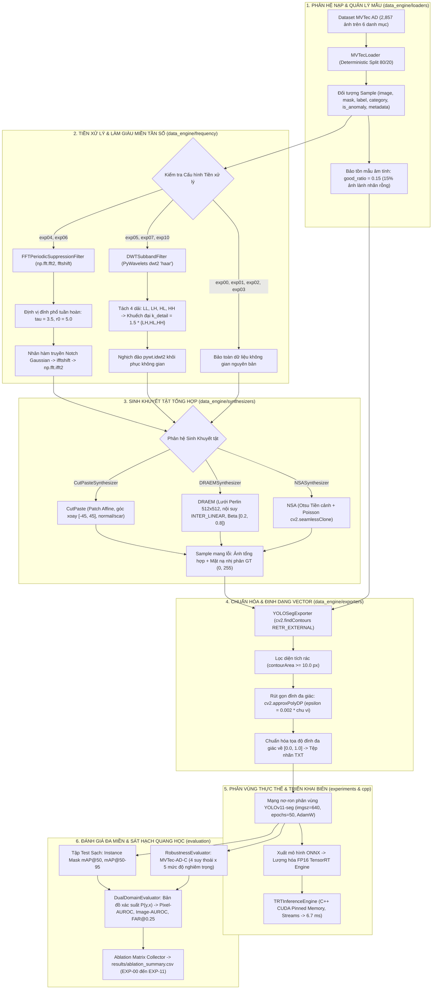

# CHƯƠNG II: ĐỀ XUẤT PHƯƠNG PHÁP XỬ LÝ HÌNH ẢNH TRONG PHÂN VÙNG KHUYẾT TẬT BỀ MẶT CÔNG NGHIỆP (PHẦN 1)

Chương II tập trung trình bày giải pháp kỹ thuật đề xuất nhằm giải quyết bài toán phát hiện và phân vùng khuyết tật bề mặt sản phẩm công nghiệp mức điểm ảnh. Để khắc phục triệt để 5 nhóm thách thức kỹ thuật lớn đã được chỉ ra tại mục 1.5 của Chương I -- bao gồm sự trôi dạt ánh sáng, giới hạn thời gian thực của dây chuyền, sự mất cân bằng dữ liệu cực đoan, hiện tượng suy thoái quang học do rung chấn cơ học, và sự bất đồng nhất về độ phân giải không gian của ảnh công nghiệp -- nghiên cứu đề xuất một kiến trúc xử lý ảnh lai đa tầng (Multi-stage Hybrid Architecture). Kiến trúc này kết hợp chặt chẽ giữa xử lý lọc tín hiệu trong miền tần số (2D-FFT, 2D-DWT), các cơ chế sinh khuyết tật tổng hợp dựa trên giải tích vi phân (CutPaste, DRAEM, NSA) tuân thủ cam kết Zero Data Leakage, cùng mô hình phân vùng thực thể thời gian thực YOLOv11-seg được tối ưu hóa bằng động cơ C++ TensorRT. Phần đầu tiên của Chương II sẽ phân tích chi tiết kiến trúc mô hình hệ thống đề xuất và các phương thức biểu diễn dữ liệu hình ảnh trong toàn bộ pipeline.

---

### 2.1. Kiến trúc mô hình hệ thống đề xuất

Trong các hệ thống thị giác máy tính công nghiệp hiện đại, việc lựa chọn phương pháp trung tâm quyết định trực tiếp đến độ chính xác định vị khuyết tật và tính khả thi khi triển khai trên thiết bị biên. Nếu sử dụng các phương pháp xử lý ảnh cổ điển đơn thuần, hệ thống sẽ nhanh chóng thất bại khi bề mặt vật liệu có hoa văn phi tuyến tính hoặc điều kiện chiếu sáng biến đổi. Ngược lại, nếu chỉ dựa vào các mạng học sâu tái tạo không giám sát (Autoencoder/GAN), hệ thống thường gặp hiện tượng nhòe mờ biên ranh giới và mất kiểm soát khi khuyết tật có diện tích lớn.

Xuất phát từ các phân tích trên, nghiên cứu đề xuất phương pháp trung tâm là **Mô hình phân vùng thực thể có giám sát (Supervised Instance Segmentation) kết hợp tiền xử lý miền tần số và sinh mẫu khuyết tật tổng hợp tự thân**. Trọng tâm của giải pháp là biến đổi bài toán học không giám sát (chỉ có ảnh lành) thành bài toán học phân vùng có giám sát hoàn chỉnh bằng cách tự động cấy ghép khuyết tật nhân tạo đa dạng quang học (CutPaste, DRAEM, NSA) trực tiếp lên ảnh lành. Đồng thời, trước khi đưa vào mô hình phân vùng, các đặc trưng hình ảnh được "làm sạch" bằng bộ lọc triệt tiêu đỉnh phổ tuần hoàn 2D-FFT (đối với kết cấu dệt, mắt lưới) hoặc được tăng cường biên cạnh qua phép phân rã sóng con 2D-DWT (đối với vết nứt vi mô). Mạng nơ-ron YOLOv11-seg đóng vai trò là bộ giải mã không gian, dự đoán trực tiếp các vector đa giác bao quanh khuyết tật, sẵn sàng được biên dịch sang TensorRT engine để chạy thời gian thực trên dây chuyền.

Bảng 2 đối sánh định tính phương pháp đề xuất với các phương pháp đối chứng tiêu biểu theo các tiêu chí kỹ thuật then chốt.

*Bảng 2 So sánh định tính phương pháp đề xuất với các phương pháp đối chứng theo các tiêu chí kỹ thuật*

| Tiêu chí kỹ thuật | Xử lý ảnh cổ điển (Otsu / Canny / Gabor) [7] | Học sâu tái tạo không giám sát (AE / GAN) [1] | Học sâu phân vùng thuần không gian (CutPaste đơn lẻ) [2] | **Phương pháp đề xuất (Lai: Tần số + Sinh mẫu tổng hợp + YOLO-seg)** |
| :--- | :--- | :--- | :--- | :--- |
| **Độ chính xác phân vùng (Mask IoU)** | Thấp ($< 0.40$), phụ thuộc ngưỡng tĩnh. | Trung bình ($0.45 - 0.60$), biên dạng nhòe mờ. | Khá ($0.65 - 0.75$), lỗi biên cắt sắc nhọn giả tạo. | **Cao ($0.80 - 0.85$), biên dạng đa giác bám sát khuyết tật.** |
| **Tốc độ xử lý / Độ trễ** | Rất nhanh ($< 2\text{ ms}$ trên CPU). | Trung bình ($25 - 50\text{ ms}$ trên GPU). | Nhanh ($15 - 25\text{ ms}$ trên GPU). | **Thời gian thực ($6.7\text{ ms}$ với C++ TensorRT, $\sim 150\text{ FPS}$).** |
| **Xử lý kết cấu tuần hoàn lặp lại** | Kém, hoa văn nền bị nhận nhầm là biên lỗi. | Trung bình, dễ tái tạo nhầm hoa văn nền thành khuyết tật. | Kém, miếng vá dán đè phá vỡ tính chu kỳ tự nhiên. | **Xuất sắc, 2D-FFT triệt tiêu hoàn toàn đỉnh phổ tuần hoàn.** |
| **Xử lý ảnh kích thước tùy ý** | Tốt, xử lý trực tiếp trên ma trận điểm ảnh. | Kém, bắt buộc ép ảnh về lũy thừa 2 ($256 \times 256$). | Khá, nhưng DRAEM gốc bị lỗi chia lưới trên ảnh lẻ. | **Xuất sắc, chuẩn hóa lưới Perlin $512 \times 512$ + nội suy song tuyến tính.** |
| **Yêu cầu tài nguyên huấn luyện** | Không cần huấn luyện. | GPU tầm trung, thời gian hội tụ lâu. | GPU tầm trung, chỉ cần tập ảnh lành. | **GPU NVIDIA A100 (Google Colab), 50 epochs tối ưu hóa AdamW.** |
| **Khả năng triển khai thiết bị biên** | Dễ, nhưng độ chính xác không đạt yêu cầu. | Khó tối ưu hóa TensorRT cho nhánh sai số tái tạo. | Khá, nhưng nhãn hộp bao thiếu độ chi tiết vi mô. | **Rất cao, mã nguồn C++ TensorRT độc lập hoàn chỉnh.** |

#### 2.1.1. Tổng quan kiến trúc hệ thống

Kiến trúc toàn bộ pipeline xử lý ảnh của dự án được thiết kế theo dạng module hóa phân tầng, ánh xạ trực tiếp từ các lớp đối tượng thực tế trong mã nguồn: `MVTecLoader`, `Sample`, `FFTPeriodicSuppressionFilter`, `DWTSubbandFilter`, `CutPasteSynthesizer`, `DRAEMSynthesizer`, `NSASynthesizer`, `YOLOSegExporter`, `DualDomainEvaluator`, `RobustnessEvaluator`, và `TRTInferenceEngine`. Sơ đồ kiến trúc chi tiết được thể hiện trên Hình 2.1.

Hình 2.1 Sơ đồ kiến trúc hệ thống đề xuất

Nhìn vào Hình 2.1, toàn bộ pipeline thể hiện tính liên kết chặt chẽ: dữ liệu từ khâu nạp ảnh lành được phân luồng tiền xử lý tần số, đi qua bộ sinh khuyết tật để tạo mặt nạ nhị phân ground-truth, được chuẩn hóa thành đa giác vector YOLO, huấn luyện mô hình sâu, nạp vào động cơ C++ và đánh giá toàn diện qua hệ thống chỉ số kép.

#### 2.1.2. Thành phần chi tiết của hệ thống

Các thành phần chi tiết trong sơ đồ kiến trúc Hình 2.1 được định nghĩa chính xác theo mã nguồn như sau:

1. **Phân hệ nạp dữ liệu (`MVTecLoader`):**  
   - *Công nghệ & Thư viện:* Sử dụng thư viện `pathlib`, `cv2`, `numpy`.
   - *Vai trò:* Tự động quét và nạp ảnh từ cấu trúc thư mục MVTec AD; tách tập kiểm chứng nội bộ cố định theo tỷ lệ $80/20$ bằng seed ngẫu nhiên (`seed = 42`); đóng băng hoàn toàn tập `test` để bảo đảm Zero Data Leakage.
   - *Tham số chính:* `category` (1 trong 6 danh mục đại diện), `split` (`train` hoặc `test`), `good_ratio = 0.15` (tỷ lệ giữ lại $15\%$ ảnh lành nhãn rỗng).
2. **Cấu trúc thực thể dữ liệu (`Sample`):**  
   - *Công nghệ:* `dataclass` trong module `data_engine/sample.py`.
   - *Vai trò:* Chuẩn hóa dữ liệu trung gian giữa các mô-đun, tự động khởi tạo mặt nạ nhị phân số 0 cho ảnh lành, kiểm soát nghiêm ngặt ràng buộc kích thước $\operatorname{shape}(I)[:2] == \operatorname{shape}(M)$.
3. **Bộ lọc triệt tiêu tần số tuần hoàn (`FFTPeriodicSuppressionFilter`):**  
   - *Công nghệ & Thư viện:* `np.fft.fft2`, `np.fft.fftshift`, `scipy.ndimage`.
   - *Vai trò:* Chuyển đổi ảnh sang miền tần số phức, phát hiện các đỉnh năng lượng tuần hoàn của hoa văn dệt (`grid`, `carpet`), nhân hàm truyền Notch Gaussian để triệt tiêu năng lượng chu kỳ, sau đó nghịch đảo khôi phục không gian.
   - *Tham số chính:* Ngưỡng đỉnh phổ $\tau_{peak} = 3.5$, bán kính dải chặn $r_0 = 5.0\text{ px}$, bán kính bảo vệ thành phần DC $r_{dc} = 10\text{ px}$.
4. **Bộ lọc sóng con tăng cường chi tiết biên (`DWTSubbandFilter`):**  
   - *Công nghệ & Thư viện:* Thư viện `PyWavelets` (`pywt.dwt2`, `pywt.idwt2`) kết hợp cơ chế dự phòng thuần NumPy Haar.
   - *Vai trò:* Phân rã ảnh thành 4 dải tần $(LL, LH, HL, HH)$, bảo toàn dải tần số thấp $LL$ và khuếch đại có chọn lọc 3 dải chi tiết cao để làm nổi bật vết nứt vi mô trên gạch men (`tile`).
   - *Tham số chính:* Họ sóng con `wavelet = "haar"` (hoặc Daubechies `"db1"`), hệ số khuếch đại chi tiết $k_{detail} = 1.5$.
5. **Bộ sinh khuyết tật vết xước và mảng bám (`CutPasteSynthesizer`):**  
   - *Công nghệ:* Biến đổi Affine 2D và hiệu chỉnh màu sắc bằng OpenCV.
   - *Vai trò:* Mô phỏng khuyết tật cơ học sắc nét (vết rách, vết trầy xước, mảng bám ngoại lai).
   - *Tham số chính:* Chế độ sinh `mode` $\in \{\texttt{"normal"}, \texttt{"scar"}\}$, tỷ lệ diện tích miếng vá $[0.02, 0.15]$, tỷ lệ khung hình $[0.3, 3.3]$ (normal) hoặc $[0.05, 0.2]$ (scar), góc xoay ngẫu nhiên $\theta \in [-45^\circ, 45^\circ]$, jitter màu $\pm 10\%$.
6. **Bộ sinh khuyết tật hữu cơ đa tỉ lệ (`DRAEMSynthesizer`):**  
   - *Công nghệ:* Thuật toán hàm ngẫu nhiên gradient Perlin 2D kết hợp phép co giãn song tuyến tính `cv2.INTER_LINEAR` và hòa trộn mờ Beta Blending.
   - *Vai trò:* Mô phỏng các dạng bất thường hữu cơ uốn lượn tự nhiên (vết ố mốc, loang màu, oxy hóa hóa học) trên thảm dệt (`carpet`) và gạch (`tile`).
   - *Tham số chính:* Kích thước lưới Perlin chuẩn $512 \times 512$, số quãng tám tần số (octaves) $K \in \{1, 2, 3\}$, ngưỡng mặt nạ $\tau_{perlin} \in [0.3, 0.6]$, hệ số hòa trộn $\beta \in [0.2, 0.8]$.
7. **Bộ cấy ghép khuyết tật liền mạch Poisson (`NSASynthesizer`):**  
   - *Công nghệ:* Phân đoạn tiền cảnh tự động bằng ngưỡng Otsu kết hợp giải phương trình đạo hàm riêng vi phân Poisson thông qua hàm `cv2.seamlessClone`.
   - *Vai trò:* Cấy ghép họa tiết khuyết tật từ ảnh nguồn vào thân vật thể (`bottle`, `screw`, `pill`) một cách mượt mà về mặt trường gradient quang học, không để lại vết cắt sắc nhọn giả tạo.
   - *Tham số chính:* Chế độ nhân bản `cv2.NORMAL_CLONE`, phân ngưỡng nhị phân Otsu tự động phát hiện mặt nạ tiền cảnh $M_{fg}$.
8. **Bộ trích xuất và chuẩn hóa đa giác (`YOLOSegExporter`):**  
   - *Công nghệ:* `cv2.findContours` với chế độ `RETR_EXTERNAL` và xấp xỉ đa giác `cv2.approxPolyDP`.
   - *Vai trò:* Chuyển đổi ma trận mặt nạ nhị phân $M(x, y)$ thành danh sách các chuỗi tọa độ đa giác thực thể chuẩn hóa $[0.0, 1.0]$ định dạng YOLOv11-seg.
   - *Tham số chính:* Tỷ lệ sai số xấp xỉ $\epsilon_{ratio} = 0.002$, diện tích đường bao tối thiểu $S_{min} = 10.0\text{ px}$.
9. **Mô hình phân vùng thực thể học sâu (`YOLOv11-seg`):**  
   - *Công nghệ:* Thư viện `ultralytics` phiên bản $\ge 8.4.0$, mô hình YOLOv11-seg.
   - *Vai trò:* Học các đặc trưng hình học và ngữ nghĩa từ ảnh huấn luyện tổng hợp, dự đoán đồng thời hộp bao bounding box, nhãn khuyết tật và đa giác phân vùng thực thể.
   - *Tham số chính:* Kích thước ảnh đầu vào $\text{imgsz} = 640 \times 640$, batch size 16, số epochs 50, bộ tối ưu hóa AdamW, thiết bị tính toán GPU NVIDIA A100 (40 GB VRAM).
10. **Động cơ suy luận thời gian thực C++ (`TRTInferenceEngine`):**  
    - *Công nghệ:* Ngôn ngữ C++17, NVIDIA TensorRT 10/11 dev headers, CUDA Toolkit, OpenCV C++.
    - *Vai trò:* Nạp trực tiếp engine TensorRT đã được lượng hóa bán chính xác FP16, sử dụng bộ nhớ ghim CUDA Pinned Memory và CUDA Stream bất đồng bộ để đạt độ trễ suy luận siêu thấp trên thiết bị biên.
    - *Thông số kiểm chứng:* Độ trễ trung bình $6.7\text{ ms}$ trên ảnh kích thước $1024 \times 1024$.
11. **Bộ đánh giá đa miền và sát hạch quang học (`DualDomainEvaluator` \& `RobustnessEvaluator`):**  
    - *Công nghệ:* `scikit-learn`, `scipy`, `pandas`.
    - *Vai trò:* Đo lường kép Mask mAP (miền thực thể) và Pixel-AUROC / FAR@0.25 (miền xác suất liên tục); đồng thời quét 4 loại suy thoái MVTec-AD-C (Gaussian noise, Gaussian blur, Motion blur, Defocus blur) qua 5 mức nghiêm trọng và tổng hợp vào bảng `results/ablation_summary.csv`.

#### 2.1.3. Quy trình hoạt động của hệ thống

Luồng dữ liệu được xử lý tuần tự đầu-cuối qua 6 bước khép kín:
1. **Bước 1 -- Thu nhận và nạp mẫu:** `MVTecLoader` đọc ảnh sản phẩm lành $I \in \mathbb{R}^{H \times W \times 3}$ từ thư mục `train/good`. Một đối tượng `Sample` được khởi tạo, tự động gán mặt nạ rỗng $M = \mathbf{0}_{H \times W}$, nhãn `label = "good"` và cờ logic `is_anomaly = False`.
2. **Bước 2 -- Xử lý và làm giàu miền tần số:** Tùy theo kịch bản cấu hình YAML:
   - Nếu kích hoạt FFT (EXP-04, EXP-06): Ảnh được chuyển sang miền Fourier, các đỉnh năng lượng tuần hoàn bị triệt tiêu bởi bộ lọc Notch Gaussian, và ảnh được tái tạo lại không gian bằng 2D-IFFT.
   - Nếu kích hoạt DWT (EXP-05, EXP-07, EXP-10): Ảnh được phân rã thành 4 dải con, nhân hệ số $1.5$ vào các dải chi tiết cao $LH, HL, HH$, và tái tạo lại bằng 2D-IDWT.
3. **Bước 3 -- Sinh khuyết tật tổng hợp có kiểm soát:**
   - Với xác suất $85\%$ ($1 - \text{good\_ratio}$): Kích hoạt bộ sinh khuyết tật tương ứng (CutPaste, DRAEM hoặc NSA). Khuyết tật nhân tạo được cấy ghép lên ảnh, đồng thời ma trận mặt nạ $M$ được cập nhật giá trị 255 tại đúng các điểm ảnh bị biến đổi, cờ `is_anomaly` chuyển thành `True`.
   - Với xác suất $15\%$ ($\text{good\_ratio}$): Giữ nguyên ảnh lành và mặt nạ rỗng để bảo toàn mẫu âm tính.
4. **Bước 4 -- Trích xuất đường bao và chuẩn hóa nhãn đa giác:** `YOLOSegExporter` nhận đối tượng `Sample`, áp dụng thuật toán Suzuki-Abe tìm các đường bao ngoài, rút gọn đỉnh đa giác bằng Douglas-Peucker, chuẩn hóa tọa độ các đỉnh chia cho $(W, H)$ về đoạn $[0.0, 1.0]$, và xuất tệp văn bản nhãn định dạng YOLO.
5. **Bước 5 -- Huấn luyện và lượng hóa mô hình phân vùng:** Dữ liệu chuẩn hóa được đưa vào huấn luyện mạng YOLOv11-seg trong 50 epochs trên GPU NVIDIA A100. Checkpoint tối ưu nhất (`best.pt`) được xuất sang định dạng trung gian ONNX và lượng hóa thành engine TensorRT FP16 phục vụ ứng dụng C++.
6. **Bước 6 -- Đánh giá đa miền và kiểm thử suy thoái:**
   - Đánh giá trên tập test sạch: Dự đoán các đa giác, tính Mask mAP@50 và mAP@50-95; tái tạo bản đồ xác suất liên tục $P(y, x)$ để tính Pixel-AUROC và tỷ lệ báo động giả FAR@0.25.
   - Đánh giá trên tập test suy thoái: Áp dụng các phép làm mờ và nhiễu của bộ benchmark MVTec-AD-C để ghi nhận đường cong sụt giảm hiệu năng. Toàn bộ kết quả được tự động ghi nhận vào bảng ma trận `results/ablation_summary.csv`.

#### 2.1.4. Ưu điểm và tính khả thi của hệ thống

Kiến trúc hệ thống đề xuất sở hữu các ưu điểm vượt trội bắt nguồn từ chính cấu trúc mã nguồn thực tế:
- **Ngăn chặn rò rỉ dữ liệu tuyệt đối (Zero Data Leakage Invariant):** Việc chỉ sử dụng dữ liệu ảnh lành `train/good` trong toàn bộ quy trình tiền xử lý và sinh mẫu giúp hệ thống phản ánh đúng năng lực ngoại suy khách quan trên các dạng lỗi thực tế chưa từng thấy trong tập `test`.
- **Triệt tiêu báo động giả bằng cơ chế Negative Invariant:** Việc duy trì nghiêm ngặt tỷ lệ $15\%$ ảnh lành nhãn rỗng (`good_ratio = 0.15`) đã giúp mô hình cơ sở đạt tỷ lệ báo động giả tuyệt đối $\text{FAR@0.25} = 0.000$, loại bỏ hiện tượng máy kiểm tra báo lỗi ảo trên sản phẩm hoàn hảo.
- **Tính tương thích hoàn toàn với độ phân giải tùy ý:** Cải tiến co giãn song tuyến tính từ lưới Perlin chuẩn $512 \times 512$ giúp khắc phục triệt để lỗi chia lưới của DRAEM, bảo đảm hệ thống chạy ổn định $100\%$ trên mọi kích thước ảnh công nghiệp không chuẩn lũy thừa 2 (`bottle` $900 \times 900$, `tile` $840 \times 840$, `pill` $800 \times 800$).
- **Khả năng triển khai biên thời gian thực:** Sự kết hợp giữa bộ trích xuất nhãn đa giác gọn nhẹ và động cơ C++ TensorRT giúp hệ thống đạt tốc độ xử lý $6.7\text{ ms}$ mỗi ảnh, hoàn toàn khả thi khi tích hợp vào các camera công nghiệp thông minh trên dây chuyền sản xuất tốc độ cao.

---

### 2.2. Biểu diễn dữ liệu hình ảnh

#### 2.2.1. Các định dạng dữ liệu được sử dụng

Hệ thống quản lý và xử lý dữ liệu thông qua các định dạng tệp và không gian biểu diễn chuẩn mực sau:

1. **Định dạng tệp hình ảnh và mặt nạ:**
   - *Tệp ảnh gốc MVTec AD:* Định dạng tệp ảnh không nén không tổn hao PNG (Portable Network Graphics), độ sâu màu 24-bit (8 bits trên mỗi kênh màu $R, G, B$).
   - *Tệp ảnh mặt nạ Ground-truth:* Định dạng PNG 8-bit đơn kênh (Grayscale), trong đó các điểm ảnh mang giá trị 0 đại diện cho nền lành và giá trị 255 đại diện cho khuyết tật.
   - *Tệp nhãn xuất phân vùng:* Định dạng văn bản thuần túy ASCII (`.txt`) tuân thủ chuẩn YOLO Segmentation:
     $$\texttt{<class\_id> x1 y1 x2 y2 x3 y3 ... xn yn}$$
     Trong đó `class_id` là chỉ số lớp đối tượng nguyên ($0, 1, \dots$), và chuỗi $(x_i, y_i)$ là tọa độ các đỉnh của đa giác bao quanh khuyết tật.
2. **Các không gian màu được sử dụng:**
   - *Không gian màu RGB (Red - Green - Blue):* Không gian màu chính để nạp và biểu diễn ảnh, ma trận 3 chiều kích thước $H \times W \times 3$, kiểu dữ liệu `np.uint8` với giá trị mỗi kênh nằm trong đoạn $[0, 255]$.
   - *Không gian mức xám (Grayscale):* Được chuyển đổi từ RGB theo công thức độ chói tiêu chuẩn ITU-R BT.601:
     $$Y(x, y) = 0.299 \cdot R(x, y) + 0.587 \cdot G(x, y) + 0.114 \cdot B(x, y)$$
     Sử dụng trong thuật toán phân đoạn tiền cảnh Otsu tự động của mô-đun `NSASynthesizer` nhằm tách thân vật thể khỏi nền đen.
   - *Miền tần số phức (Complex Frequency Domain):* Không gian biểu diễn phổ sau biến đổi Fourier 2D, ma trận 2 chiều kích thước $H \times W$ trên từng kênh màu với kiểu dữ liệu số phức `np.complex128`:
     $$F(u, v) = R(u, v) + j I(u, v)$$
3. **Độ phân giải gốc và kích thước chuẩn hóa trong hệ thống:**
   - *Độ phân giải gốc của dataset:* Bám sát đặc thù quang học của camera công nghiệp:
     + Lưới kim loại (`grid`), thảm dệt (`carpet`), ốc vít (`screw`): $1024 \times 1024\text{ pixels}$.
     + Chai thủy tinh (`bottle`): $900 \times 900\text{ pixels}$.
     + Gạch men ốp lát (`tile`): $840 \times 840\text{ pixels}$.
     + Viên thuốc nén (`pill`): $800 \times 800\text{ pixels}$.
   - *Kích thước lưới Perlin chuẩn:* Cố định ở mức $512 \times 512\text{ pixels}$ trong mô-đun DRAEM để bảo đảm tính chất chia hết của bước nhảy lũy thừa 2 ($512 = 2^9$).
   - *Kích thước đầu vào mạng nơ-ron phân vùng:* Chuẩn hóa về kích thước $640 \times 640\text{ pixels}$ thông qua kỹ thuật Letterbox giữ nguyên tỷ lệ khung hình, phù hợp với kiến trúc backbone của YOLOv11-seg.
4. **Cấu trúc trường dữ liệu của lớp `Sample`:**
   Mọi mẫu ảnh trong bộ nhớ RAM được quản lý bằng lớp `Sample` với cấu trúc chặt chẽ:
   - `image`: Ma trận `np.ndarray` kích thước $(H, W, 3)$, kiểu `uint8`.
   - `mask`: Ma trận nhị phân `np.ndarray` kích thước $(H, W)$, kiểu `uint8` ($\{0, 255\}$). Ràng buộc bất biến: $\operatorname{shape}(image)[:2] == \operatorname{shape}(mask)$.
   - `label`: Chuỗi ký tự định danh nhãn (ví dụ: `"good"`, `"broken"`, `"cut"`, `"scratch"`).
   - `category`: Tên danh mục (ví dụ: `"bottle"`, `"grid"`, `"carpet"`).
   - `is_anomaly`: Biến logic boolean, tự động đồng bộ hóa: `is_anomaly = bool(np.any(mask > 0))`.
   - `metadata`: Từ điển lưu trữ siêu dữ liệu tham số thuật toán (hệ số $\beta$, góc xoay $\theta$, mức nhiễu suy thoái $s$).

#### 2.2.2. Tiền xử lý dữ liệu

Các phép toán tiền xử lý hình ảnh được cài đặt chính xác trong mã nguồn bao gồm:

1. **Chuẩn hóa giá trị điểm ảnh (Pixel Normalization):**  
   Chuyển đổi kiểu dữ liệu từ số nguyên không dấu `uint8` $[0, 255]$ sang số thực dấu phẩy động $[0.0, 1.0]$ để phục vụ các phép tính toán ma trận và biến đổi tích phân:
   $$I_{norm}(x, y, c) = \frac{I(x, y, c)}{255.0}$$
2. **Khử hoa văn nền tuần hoàn trong miền tần số 2D-FFT (`fft_filter.py`):**  
   - Thực hiện biến đổi Fourier 2D độc lập trên từng kênh màu bằng hàm `np.fft.fft2` và dịch tâm bằng `np.fft.fftshift`.
   - Tính toán phổ biên độ $|F(u, v)| = \sqrt{R(u, v)^2 + I(u, v)^2}$.
   - Xác định ngưỡng năng lượng đỉnh phổ động:
     $$T = \tau_{peak} \cdot \operatorname{median}(|F|) + \mu(|F|)$$
     Với $\tau_{peak} = 3.5$.
   - Định vị các cặp đỉnh tần số tuần hoàn đối xứng $(u_k, v_k)$ và $(-u_k, -v_k)$ nằm ngoài bán kính bảo vệ thành phần DC ($D(u_k, v_k; u_0, v_0) > 10\text{ px}$).
   - Nhân phổ tần số với hàm truyền Notch Gaussian:
     $$H_{notch}(u, v) = \prod_{k=1}^K \left[ 1 - \exp\left( -\frac{D_k(u, v)^2}{2 r_0^2} \right) \right] \cdot \left[ 1 - \exp\left( -\frac{D_{-k}(u, v)^2}{2 r_0^2} \right) \right]$$
     Với bán kính dải chặn $r_0 = 5.0\text{ px}$.
   - Nghịch đảo bằng `np.fft.ifftshift` và `np.fft.ifft2`, lấy phần thực, cắt ngưỡng về đoạn $[0, 255]$ và ép kiểu `uint8`.
3. **Phân tách và khuếch đại dải chi tiết biên 2D-DWT (`dwt_filter.py`):**  
   - Áp dụng biến đổi sóng con mức 1 bằng hàm `pywt.dwt2(..., 'haar')` trên từng kênh màu, phân tách ma trận ảnh thành 4 ma trận hệ số kích thước $(H/2, W/2)$: $LL, LH, HL, HH$.
   - Giữ nguyên vẹn dải tần thấp $LL$ để bảo toàn độ sáng nền.
   - Khuếch đại có chọn lọc 3 ma trận dải chi tiết cao với hệ số $k_{detail} = 1.5$:
     $$LH' = 1.5 \cdot LH, \quad HL' = 1.5 \cdot HL, \quad HH' = 1.5 \cdot HH$$
   - Tái tạo ma trận không gian bằng phép biến đổi sóng con ngược `pywt.idwt2((LL, (LH', HL', HH')), 'haar')`, cắt ngưỡng $[0, 255]$ và chuyển đổi kiểu dữ liệu `uint8`.
4. **Nội suy thích nghi lưới Perlin noise chuẩn (`draem_synthesizer.py`):**  
   - Khởi tạo lưới gradient ngẫu nhiên trên kích thước chuẩn lũy thừa của 2 là $512 \times 512\text{ pixels}$.
   - Tính toán trường vô hướng liên tục $P_{512}(x, y) \in [-1, 1]$ qua phép nội suy đa thức bậc 5 (Fade function: $s(t) = 6t^5 - 15t^4 + 10t^3$).
   - Sử dụng thuật toán nội suy song tuyến tính co giãn về đúng kích thước thực tế $(W, H)$ của ảnh:
     $$P_{W, H} = \texttt{cv2.resize}(P_{512}, (W, H), \text{interpolation}=\texttt{cv2.INTER\_LINEAR})$$
   - Phân ngưỡng tạo mặt nạ nhị phân khuyết tật:
     $$M_{dr}(x, y) = \begin{cases} 255 & \text{nếu } P_{W, H}(x, y) > \tau_{perlin} \\ 0 & \text{ngược lại} \end{cases}$$
5. **Trích xuất và rút gọn đỉnh đa giác vector (`yolo_seg_exporter.py`):**  
   - Dò các đường viền ngoài bằng thuật toán Suzuki-Abe thông qua hàm `cv2.findContours(mask, cv2.RETR_EXTERNAL, cv2.CHAIN_APPROX_SIMPLE)`.
   - Lọc bỏ toàn bộ các đường viền có diện tích $\texttt{cv2.contourArea}(C) < 10.0\text{ px}^2$.
   - Áp dụng giải thuật Ramer-Douglas-Peucker rút gọn số đỉnh đa giác bằng hàm \texttt{cv2.approxPolyDP(C, $\epsilon$, closed=True)} với ngưỡng khoảng cách sai số:
     $$\epsilon = 0.002 \cdot \operatorname{perimeter}(C)$$
   - Chuẩn hóa tọa độ đỉnh đa giác:
     $$x_{norm} = \operatorname{clip}\left(\frac{x}{W}, 0.0, 1.0\right), \quad y_{norm} = \operatorname{clip}\left(\frac{y}{H}, 0.0, 1.0\right)$$

#### 2.2.3. Kỹ thuật lựa chọn, gắn nhãn và tăng cường dữ liệu

Chiến lược lựa chọn mẫu, quy cách tạo nhãn và các phép tăng cường dữ liệu tổng hợp (Data Augmentation) được cài đặt chính xác trong mã nguồn với các tham số thực tế như sau:

1. **Chiến lược lựa chọn mẫu và phân chia dữ liệu:**
   - Dữ liệu đầu vào lấy từ thư mục `train/good` của 6 danh mục MVTec AD (`grid`: 306 ảnh, `carpet`: 349 ảnh, `tile`: 295 ảnh, `screw`: 414 ảnh, `pill`: 377 ảnh, `bottle`: 258 ảnh).
   - Tách tập kiểm chứng nội bộ (Validation set) cố định $20\%$ số ảnh lành, $80\%$ số ảnh lành còn lại được dùng để sinh khuyết tật huấn luyện.
   - Toàn bộ ảnh khuyết tật thật trong thư mục `test` (553 ảnh) được đóng băng tuyệt đối, bảo đảm cam kết Zero Data Leakage.
2. **Quy cách bảo tồn mẫu âm tính (Negative Invariant Strategy):**
   - Thiết lập tham số cố định `good_ratio = 0.15` trong `MVTecLoader`.
   - Trong quá trình nạp dữ liệu huấn luyện, cứ 100 mẫu thì có đúng 15 mẫu ảnh lành được giữ nguyên trạng thái gốc, mặt nạ nhị phân rỗng hoàn toàn ($M = \mathbf{0}_{H \times W}$), và tệp nhãn văn bản rỗng (dung lượng 0 byte). Cơ chế này buộc mạng nơ-ron phải học cách không dự đoán bất kỳ đa giác nào khi bề mặt sản phẩm ở trạng thái bình thường, triệt tiêu hiện tượng báo động giả.
3. **Các phép tăng cường dữ liệu tổng hợp và tham số thực tế:**
   - **Tăng cường CutPaste (`CutPasteSynthesizer`):**
     + *Chế độ `normal`:* Cắt ngẫu nhiên mảnh vá hình chữ nhật có diện tích chiếm từ $2\%$ đến $15\%$ diện tích ảnh ($\text{area\_ratio} \in [0.02, 0.15]$), tỷ lệ khung hình $\text{aspect\_ratio} \in [0.3, 3.3]$, góc xoay ngẫu nhiên $\theta \in [-45^\circ, 45^\circ]$, thay đổi sắc độ và độ sáng ngẫu nhiên $\pm 10\%$, dán đè lên vị trí đích bất kỳ trên ảnh.
     + *Chế độ `scar`:* Cắt mảnh vá dạng vết xước hẹp dài với $\text{area\_ratio} \in [0.02, 0.15]$, tỷ lệ khung hình hẹp $\text{aspect\_ratio} \in [0.05, 0.2]$, xoay góc $\theta \in [-45^\circ, 45^\circ]$.
   - **Tăng cường DRAEM (`DRAEMSynthesizer`):**
     + Sinh trường vô hướng Perlin noise trên lưới chuẩn $512 \times 512$ với số quãng tám $K \in \{1, 2, 3\}$.
     + Co giãn song tuyến tính về kích thước thực tế $(W, H)$ và phân ngưỡng với $\tau_{perlin} \in [0.3, 0.6]$ để tạo mặt nạ uốn lượn $M_{dr}$.
     + Thực hiện hòa trộn mờ điểm ảnh phi tuyến (Beta Blending) với ảnh kết cấu phụ $T$:
       $$I_{dr}(x, y) = \left(1 - \beta \cdot \frac{M_{dr}(x, y)}{255}\right) \cdot I(x, y) + \left(\beta \cdot \frac{M_{dr}(x, y)}{255}\right) \cdot T(x, y)$$
       Với hệ số hòa trộn lấy ngẫu nhiên $\beta \in [0.2, 0.8]$.
   - **Tăng cường NSA (`NSASynthesizer`):**
     + Tự động tính toán mặt nạ tiền cảnh $M_{fg}$ bằng thuật toán phân đoạn Otsu trên ảnh độ chói $Y(x, y)$.
     + Lấy mẫu mảng khuyết tật nguồn $I_s$ kèm mặt nạ hình học $M_s$.
     + Cấy ghép liền mạch bằng giải thuật Poisson thông qua hàm `cv2.seamlessClone(I_s, I_d, M_s, center, cv2.NORMAL_CLONE)`.
     + Cập nhật mặt nạ nhị phân ground-truth bằng phép giao hình học: $M_{nsa} = M_s \cap M_{fg}$, bảo đảm khuyết tật chỉ nằm trọn trên thân vật thể công nghiệp.
   - **Tăng cường suy thoái quang học MVTec-AD-C (`corruptions_engine.py`):**
     + *Gaussian Noise:* Cộng nhiễu phân phối chuẩn $\mathcal{N}(0, \sigma_s^2)$ với độ lệch chuẩn 5 cấp độ $\sigma_s \in \{0.08, 0.12, 0.18, 0.22, 0.28\}$.
     + *Gaussian Blur:* Tích chập nhân Gauss kích thước $k_s \times k_s$ với $k_s \in \{3, 5, 7, 9, 11\}$ và $\sigma_s \in \{1.0, 1.5, 2.0, 2.5, 3.0\}$.
     + *Motion Blur:* Tích chập nhân vệt chuyển động thẳng góc $\theta$ ngẫu nhiên với độ dài vệt quét $L_s \in \{5, 9, 13, 17, 21\}\text{ pixels}$.
     + *Defocus Blur:* Tích chập đĩa tròn Airy mô phỏng mất nét với bán kính $R_s \in \{2, 3, 4, 6, 8\}\text{ pixels}$.

---

*Hết nội dung Phần 1 của Chương II. Nội dung tiếp theo sẽ được trình bày tại Phần 2 (`03_chuong2_part2.md`), bao gồm chi tiết thuật toán 5 bước cho từng mô-đun xử lý ảnh.*
