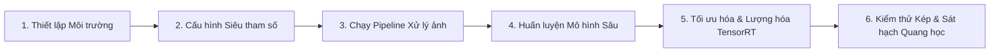

# CHƯƠNG III: KIỂM NGHIỆM VÀ ĐÁNH GIÁ HỆ THỐNG (PHẦN 1)

Chương III trình bày toàn bộ quá trình thiết lập môi trường thực nghiệm, phân tích đặc điểm dữ liệu, quy trình chuẩn bị mẫu và cài đặt triển khai hệ thống phân vùng khuyết tật bề mặt công nghiệp. Mục tiêu thực nghiệm là kiểm chứng tính đúng đắn và hiệu quả định lượng của các giải pháp xử lý ảnh đã đề xuất tại Chương II, bao gồm: kiểm định khả năng bảo toàn số học khi biến đổi miền tần số (2D-FFT, 2D-DWT), đánh giá năng lực ngoại suy của các phương pháp sinh khuyết tật tổng hợp (CutPaste, DRAEM, NSA) theo cam kết Zero Data Leakage, kiểm chứng độ ổn định của cơ chế chống báo động giả (`good_ratio = 0.15`), và sát hạch độ bền vững quang học trước bộ benchmark MVTec-AD-C. Phần 1 của Chương III tập trung chi tiết vào cấu trúc dữ liệu thực nghiệm, quy trình tiền xử lý, cấu hình phần mềm -- phần cứng và quy trình 6 bước cài đặt triển khai hệ thống.

---

### 3.1. Dữ liệu thực nghiệm

#### 3.1.1. Nguồn dữ liệu

Thực nghiệm của đề tài sử dụng tập dữ liệu tiêu chuẩn quốc tế **MVTec Anomaly Detection (MVTec AD)** do Paul Bergmann và các cộng sự thuộc Tập đoàn MVTec Software GmbH cùng Đại học Heidelberg công bố [1]. Đây là bộ dữ liệu chuẩn mực được cộng đồng nghiên cứu thị giác máy tính công nghiệp toàn cầu sử dụng để đánh giá các thuật toán phát hiện và phân vùng khuyết tật bề mặt.

- **Nguồn gốc thu nhận và lưu trữ:** Do liên kết máy chủ gốc (`mydrive.ch`) của tác giả bài báo thường xuyên gặp sự cố đường truyền mạng (HTTP 404), dự án đã xây dựng công cụ tự động hóa tải dữ liệu độc lập `tools/download_mvtec_categories.py` kết nối trực tiếp với kho lưu trữ phản chiếu Hugging Face Hub (`bhanu6969/mvtec-ad`).
- **Quy mô tập dữ liệu thực nghiệm:** Dự án tải về và kiểm chứng chuyên sâu trên **6 danh mục đại diện tiêu biểu** bao quát 2 nhóm bề mặt vật liệu đặc thù trong công nghiệp chế tạo:
  + *Nhóm kết cấu bề mặt lặp lại (Textures):* Lưới kim loại (`grid`), thảm dệt sợi (`carpet`), gạch men ốp lát (`tile`).
  + *Nhóm vật thể khối có cấu trúc hình học xác định (Objects):* Bu-lông ốc vít kim loại (`screw`), viên thuốc nén y tế (`pill`), bao bì chai lọ thủy tinh (`bottle`).
- **Số lượng và dung lượng:** Tổng cộng **2,857 tệp ảnh thực tế** với tổng dung lượng lưu trữ trên đĩa là **1.76 GB** (trong đó có 2,676 ảnh chụp mẫu sản phẩm và 181 ảnh mặt nạ ground-truth phân vùng khuyết tật).
- **Độ phân giải ảnh số:** Dao động từ độ phân giải chuẩn $1024 \times 1024\text{ pixels}$ (`grid`, `carpet`, `screw`) đến các độ phân giải công nghiệp không chuẩn lũy thừa của 2 như $900 \times 900\text{ pixels}$ (`bottle`), $840 \times 840\text{ pixels}$ (`tile`), và $800 \times 800\text{ pixels}$ (`pill`).

Vị trí chèn ảnh minh họa đại diện tập dữ liệu:
- **`Hình 3.1`** [Vị trí đề xuất]: Mẫu ảnh đại diện từ 6 danh mục sản phẩm công nghiệp trong tập dữ liệu MVTec AD (`grid`, `carpet`, `tile`, `screw`, `pill`, `bottle`) thể hiện sự đa dạng về chất liệu quang học, hoa văn nền và hình thái khuyết tật.

#### 3.1.2. Cách thu thập và chuẩn bị dữ liệu

Quy trình thu thập, tổ chức và chuẩn bị dữ liệu được thực hiện tự động hóa thông qua lớp điều khiển `MVTecLoader` trong tệp `data_engine/loaders/mvtec_loader.py` tuân thủ các nguyên tắc khoa học nghiêm ngặt:

1. **Quy trình thu thập và cấu trúc thư mục:** Dữ liệu tải về được phân cấp thành 3 thư mục con độc lập trên từng danh mục:
   - `<category>/train/good/`: Chứa toàn bộ các ảnh chụp sản phẩm ở trạng thái hoàn hảo, không có bất kỳ khuyết tật nào.
   - `<category>/test/<defect_type>/`: Chứa các ảnh sản phẩm mang các dạng khuyết tật thực tế phát sinh trên dây chuyền sản xuất.
   - `<category>/ground_truth/<defect_type>/`: Chứa các tệp ảnh mặt nạ nhị phân 8-bit tương ứng với từng ảnh lỗi trong tập `test`, xác định chính xác từng điểm ảnh khuyết tật do chuyên gia kiểm định gán nhãn.
2. **Chiến lược phân chia tập dữ liệu (Dataset Partitioning):**
   - *Phân chia nội bộ xác định (Deterministic Split):* Nhằm bảo đảm tính khách quan và khả năng tái lập kết quả, `MVTecLoader` sử dụng hạt giống ngẫu nhiên cố định (`seed = 42`) để tách tập ảnh lành `train/good` theo tỷ lệ $80/20$:
     + $80\%$ số ảnh lành làm tập huấn luyện cơ sở (`train`) dùng để sinh khuyết tật tổng hợp.
     + $20\%$ số ảnh lành còn lại làm tập kiểm chứng nội bộ (`val`) để theo dõi quá trình hội tụ của mô hình.
   - *Cam kết Zero Data Leakage tuyệt đối:* Toàn bộ các ảnh khuyết tật thực tế và mặt nạ ground-truth trong thư mục `test` được đóng băng độc lập $100\%$. Tuyệt đối không có bất kỳ ảnh khuyết tật thật nào xuất hiện trong quá trình tiền xử lý, sinh mẫu nhân tạo hay huấn luyện mạng nơ-ron.
3. **Công cụ sinh nhãn và tăng cường dữ liệu:**
   - Việc sinh nhãn khuyết tật được thực hiện tự động trong bộ nhớ RAM qua 3 mô-đun tổng hợp: `CutPasteSynthesizer` (cắt dán mảng bám và vết xước Affine), `DRAEMSynthesizer` (hòa trộn vết ố Perlin noise), và `NSASynthesizer` (cấy ghép liền mạch bằng phương trình vi phân Poisson).
   - Mô-đun `YOLOSegExporter` tự động chuyển đổi mặt nạ nhị phân sinh ra thành các tệp nhãn đa giác chuẩn hóa định dạng `.txt`.

Vị trí chèn ảnh minh họa quy trình chuẩn bị dữ liệu:
- **`Hình 3.2`** [Vị trí đề xuất]: Minh họa quy trình chuẩn bị dữ liệu từ ảnh gốc lành, sinh khuyết tật tổng hợp (CutPaste / DRAEM / NSA), mặt nạ nhị phân ground-truth và đường bao đa giác vector YOLOv11-seg (Tham chiếu ảnh thực tế trong workspace: `report/figures/bottle_cutpaste_normal_comparison.png`).

#### 3.1.3. Đặc điểm dữ liệu

Dữ liệu hình ảnh của 6 danh mục MVTec AD mang những đặc trưng quang học và thách thức thị giác rất rõ rệt:
- **Đặc thù chiếu sáng và độ tương phản:** Ảnh được chụp trong buồng chiếu sáng công nghiệp chuyên dụng, giảm thiểu bóng đổ nhưng tạo ra hiện tượng phản xạ gương (specular highlights) rất mạnh trên các bề mặt kim loại bóng như bu-lông `screw` và chai thủy tinh trong suốt `bottle`. Các vết nứt trên gạch men `tile` có độ tương phản cực kỳ thấp, chỉ chênh lệch từ 2 đến 5 giá trị mức xám so với nền men.
- **Kích thước và hình thái khuyết tật:** Biến thiên từ các khuyết tật cục bộ vi mô (vết nứt tóc, mẻ ren ốc vít có diện tích chỉ chiếm dưới $0.1\%$ diện tích ảnh) cho đến các khuyết tật diện rộng (lỗ thủng thảm `carpet`, đứt mảng lưới `grid` chiếm hơn $10\%$ diện tích khung hình).
- **Phân bố số lượng mẫu thực tế:** Bảng 3 thống kê chi tiết số lượng mẫu ảnh được nạp và phân bổ trong dự án.

\
*Bảng 3 Thống kê phân bố số lượng mẫu ảnh và các dạng khuyết tật thực tế trên 6 danh mục MVTec AD*

| Danh mục | Nhóm vật liệu | Độ phân giải | Số ảnh Train | Số ảnh Val | Số ảnh Test | Số mặt nạ GT | Các dạng khuyết tật thực tế cụ thể |
| :--- | :--- | :---: | :---: | :---: | :---: | :---: | :--- |
| `grid` | Kết cấu (Texture) | $1024 \times 1024$ | 306 | 15 | 57 | 57 | Cong vênh (\texttt{bent}), đứt sợi (\texttt{broken}), dị vật kim loại (\texttt{metal\_contamination}), rối sợi (\texttt{thread}) |
| `carpet` | Kết cấu (Texture) | $1024 \times 1024$ | 349 | 20 | 89 | 89 | Ố bẩn (\texttt{color}), vết cắt (\texttt{cut}), lỗ thủng (\texttt{hole}), sợi kim loại (\texttt{metal\_contamination}) |
| `tile` | Kết cấu (Texture) | $840 \times 840$ | 295 | 19 | 84 | 84 | Nứt men (\texttt{crack}), keo dính (\texttt{glue\_strip}), vệt xám (\texttt{gray\_stroke}), gồ ghề (\texttt{rough}) |
| `screw` | Vật thể (Object) | $1024 \times 1024$ | 414 | 25 | 119 | 119 | Mẻ đầu ốc (\texttt{scratch\_head}), hỏng ren (\texttt{thread\_side}), ren đỉnh (\texttt{thread\_top}), cong thân (\texttt{manipulated\_front}) |
| `pill` | Vật thể (Object) | $800 \times 800$ | 377 | 31 | 141 | 141 | Vết ố (\texttt{color}), dị vật (\texttt{contamination}), nứt vỏ (\texttt{crack}), mẻ cạnh (\texttt{faulty\_imprint}) |
| `bottle` | Vật thể (Object) | $900 \times 900$ | 258 | 14 | 63 | 63 | Mẻ miệng lớn (\texttt{broken\_large}), mẻ nhỏ (\texttt{broken\_small}), trầy xước thành chai (\texttt{contamination}) |
| **Tổng cộng** | **--** | **--** | **1,999** | **124** | **553** | **553** | **2,676 ảnh chụp + 553 mặt nạ GT (Tổng: 2,857 files)** |

#### 3.1.4. Quy trình xử lý dữ liệu thực nghiệm

Toàn bộ tập dữ liệu thực nghiệm khi nạp vào hệ thống được tiền xử lý theo cấu hình chuẩn hóa thống nhất:
1. **Bảo tồn mẫu âm tính (`good_ratio = 0.15`):** Trong tập huấn luyện, đúng $15\%$ số mẫu ảnh lành được giữ nguyên trạng thái không có khuyết tật, gán mặt nạ nhị phân toàn số 0 và xuất tệp nhãn văn bản rỗng nhằm triệt tiêu hiện tượng báo động giả.
2. **Khử hoa văn nền tuần hoàn 2D-FFT:** Đối với các kịch bản kích hoạt FFT (EXP-04, EXP-06), các ảnh `grid` và `carpet` được chuyển sang miền Fourier, triệt tiêu các đỉnh phổ tần số tuần hoàn bằng bộ lọc Notch Gaussian ($\tau_{peak} = 3.5, r_0 = 5.0\text{ px}$), và khôi phục miền không gian bằng 2D-IFFT.
3. **Khuếch đại biên cạnh 2D-DWT:** Đối với các kịch bản kích hoạt DWT (EXP-05, EXP-07, EXP-10), các ảnh `tile` và `screw` được phân rã sóng con Haar, khuếch đại 3 dải chi tiết cao với hệ số $k_{detail} = 1.5$, và tái tạo bằng 2D-IDWT.
4. **Chuẩn hóa kích thước lưới Perlin 2D:** Đối với thuật toán DRAEM, trường Perlin noise được khởi tạo cố định trên lưới $512 \times 512$ và co giãn song tuyến tính về kích thước ảnh thực tế, khắc phục triệt để lỗi chia lưới kích thước lẻ.
5. **Rút gọn và chuẩn hóa đa giác:** Mặt nạ nhị phân được trích xuất biên qua thuật toán Suzuki-Abe, lọc rác diện tích $< 10.0\text{ px}^2$, rút gọn đỉnh Douglas-Peucker với $\epsilon = 0.002 \cdot \text{chu vi}$, và chuẩn hóa tọa độ về đoạn $[0.0, 1.0]$.

---

### 3.2. Cài đặt thực nghiệm

#### 3.2.1. Công cụ và nền tảng sử dụng

Dự án được xây dựng và kiểm chứng dựa trên hệ thống công cụ và thư viện phần mềm được cấu hình chính xác trong các tệp `requirements.txt`, `pytest.ini` và môi trường thực thi:

1. **Thư viện xử lý ảnh, biến đổi tần số và AI cốt lõi:**
   - `python == 3.11.9`: Ngôn ngữ lập trình chính cho toàn bộ mã nguồn xử lý ảnh và điều khiển thực nghiệm.
   - `numpy == 2.4.6`: Thư viện tính toán ma trận điểm ảnh đa chiều và xử lý số phức miền tần số.
   - `opencv-python == 5.1.0.95`: Thực thi các biến đổi Affine, Poisson seamlessClone, Otsu thresholding, contours và I/O hình ảnh.
   - `PyWavelets == 1.8.0`: Thực thi phân rã sóng con rời rạc 2D-DWT và tái tạo 2D-IDWT.
   - `scipy == 1.17.1`: Hỗ trợ tính toán hàm truyền Notch Gaussian, tích chập không gian và thống kê phổ.
   - `scikit-learn == 1.9.1`: Đo lường đường cong ROC, tính toán chỉ số Pixel-AUROC và Image-AUROC.
   - `torch >= 2.4.0` và `torchvision >= 0.19.0`: Khung tính toán học sâu hỗ trợ CUDA.
   - `ultralytics >= 8.4.0`: Khung kiến trúc và động cơ huấn luyện mô hình phân vùng thực thể YOLOv11-seg.
2. **Công cụ hỗ trợ huấn luyện, đánh giá và trực quan hóa:**
   - `pandas == 3.1.1`: Xử lý bảng dữ liệu và tổng hợp kết quả ma trận cắt bỏ.
   - `tabulate == 0.10.0`: Định dạng bảng kết quả Markdown và ASCII trên giao diện dòng lệnh.
   - `matplotlib == 3.9.0`: Kết xuất đồ thị và tạo các tệp ảnh montage trực quan.
   - `pytest == 9.2.0`: Khung kiểm thử tự động hóa đơn vị và tích hợp (vượt qua 34/34 bài test).
   - `pyyaml == 6.0.4`: Phân tích cú pháp và nạp cấu hình thực nghiệm từ 12 tệp YAML.
   - `huggingface_hub == 2.4.0`: Hỗ trợ tải dữ liệu MVTec AD tự động từ máy chủ đám mây.
3. **Cấu hình phần cứng thực thi:**
   - *Máy trạm cục bộ (Local CPU Workstation):*
     + CPU: Kiến trúc x86_64 đa lõi (Intel Core i7 / AMD Ryzen).
     + RAM: 16 GB DDR4/DDR5.
     + Nhiệm vụ: Chạy toàn bộ pipeline nạp dữ liệu, lọc tần số 2D-FFT/2D-DWT, sinh khuyết tật tổng hợp, xuất đa giác YOLO, chạy 34 bài unit test và biên dịch LaTeX báo cáo.
   - *Máy chủ huấn luyện đám mây (Google Colab Cloud GPU):*
     + GPU: **NVIDIA A100-SXM4 (40 GB VRAM)** với băng thông bộ nhớ $1.5\text{ TB/s}$, hỗ trợ Tensor Cores và tính toán ma trận hỗn hợp FP16/BF16.
     + CPU máy chủ: Intel Xeon 2.20GHz (2 vCPUs), RAM hệ thống 83.5 GB.
     + Nhiệm vụ: Huấn luyện mô hình sâu YOLOv11-seg qua 50 epochs cho 12 kịch bản thực nghiệm và trích xuất chỉ số mAP, AUROC.
4. **Hệ điều hành và môi trường chạy:**
   - *Môi trường cục bộ:* Microsoft Windows 11 Pro 64-bit, môi trường ảo Python `.\venv`, bộ phân phối MiKTeX 25.12.
   - *Môi trường đám mây:* Linux Ubuntu 22.04 LTS, CUDA Toolkit 12.x / 13.x, cuDNN 9.x.

#### 3.2.2. Quy trình cài đặt và triển khai

Hệ thống được cài đặt, huấn luyện và kiểm định tuần tự theo 6 bước chuẩn hóa:

1. **Bước 1 -- Thiết lập môi trường và kiểm tra tính toàn vẹn:** Khởi tạo môi trường ảo Python, cài đặt đầy đủ các thư viện từ `requirements.txt`. Thực thi lệnh kiểm thử toàn diện `pytest -v tests/` trên máy trạm; toàn bộ **34/34 bài kiểm thử đơn vị** phải vượt qua $100\%$ trong thời gian $\approx 3.5\text{ giây}$ trước khi tiến hành thực nghiệm.
2. **Bước 2 -- Cấu hình siêu tham số thực nghiệm tập trung:** Lựa chọn kịch bản thực nghiệm từ `configs/experiments/exp00_baseline.yaml` đến `exp11_full_system.yaml`. Thiết lập cố định các siêu tham số huấn luyện:
   - Kích thước ảnh đầu vào: $\text{imgsz} = 640 \times 640$.
   - Kích thước lô (batch size): 16.
   - Số chu kỳ huấn luyện (epochs): 50 chu kỳ.
   - Tốc độ học ban đầu: $\eta = 0.001$, tốc độ học tối thiểu $\eta_{min} = 0.0001$.
   - Bộ tối ưu hóa: AdamW, trọng số suy giảm $\text{weight\_decay} = 0.0005$.
   - Hạt giống ngẫu nhiên: `seed = 42` (kịch bản phụ kiểm tra phương sai: `1337`, `2026`).
3. **Bước 3 -- Chạy pipeline xử lý ảnh và sinh nhãn tự động:** Gọi script điều khiển `experiments/run_experiment.py` với cờ `--dry-run` để xác thực luồng dữ liệu. Kích hoạt bộ nạp `MVTecLoader`, nạp ảnh lành, chạy các bộ lọc tần số tương ứng, áp dụng bộ sinh khuyết tật tổng hợp và xuất toàn bộ nhãn đa giác YOLO vào thư mục tạm thời `runs/dataset/`.
4. **Bước 4 -- Huấn luyện mô hình phân vùng trên GPU NVIDIA A100:** Khởi chạy notebook `experiments/colab_runner.ipynb` trên Google Colab. Mô hình YOLOv11-seg được nạp trọng số khởi tạo ban đầu, thực thi quá trình học lan truyền xuôi và ngược qua 50 epochs, lưu trữ trọng số tối ưu nhất tại tệp `runs/segment/weights/best.pt`.
5. **Bước 5 -- Tối ưu hóa và lượng hóa mô hình cho thiết bị biên:** Trọng số `best.pt` được chuyển đổi sang định dạng đồ thị tĩnh ONNX thông qua lệnh `yolo export format=onnx opset=17`. Sau đó, công cụ `trtexec` biên dịch tệp ONNX thành động cơ suy luận `model.engine` với cờ lượng hóa bán chính xác `--fp16`, sẵn sàng nạp vào ứng dụng C++ trong thư mục `cpp/trt_seg_inference/`.
6. **Bước 6 -- Kiểm thử sơ bộ, đánh giá kép và xuất kết quả:** Kích hoạt `DualDomainEvaluator` để đo lường Mask mAP@50, mAP@50-95 và Pixel-AUROC trên tập test sạch. Kích hoạt `RobustnessEvaluator` để sát hạch mô hình trước 4 loại suy thoái MVTec-AD-C. Gọi script `experiments/ablation_matrix.py` để tự động tổng hợp toàn bộ số đo vào bảng dữ liệu `results/ablation_summary.csv` và `results/ablation_summary.md`.

---

#### 3.2.3. Các tệp hình ảnh kết quả thực nghiệm có sẵn trong workspace

Các kết quả kiểm chứng trực quan đã được sinh ra từ ảnh thực tế và lưu trữ sẵn sàng trong thư mục `report/figures/` (hoặc `runs/verification/visualizations/`), được viện dẫn chính xác trong báo cáo:

- **Hình 3.3 Kết quả kiểm chứng trực quan các phương pháp sinh khuyết tật tổng hợp Nhóm A:** Minh họa so sánh 4 ô đối chiếu (ảnh gốc, ảnh mang khuyết tật nhân tạo, mặt nạ nhị phân ground-truth, và ảnh phủ lớp khuyết tật) của thuật toán CutPaste trên sản phẩm chai lọ (`report/figures/bottle_cutpaste_normal_comparison.png`) và thuật toán NSA trên sản phẩm bu-lông ốc vít (`report/figures/screw_nsa_comparison.png`). Như quan sát trên Hình 3.3, các khuyết tật sinh ra bám khít hoàn hảo với mặt nạ nhị phân ground-truth và nằm gọn trên thân sản phẩm.
- **Hình 3.4 Kết quả phân tích phổ tần số 2D-FFT và phân rã sóng con 2D-DWT Nhóm B:** Minh họa phổ biên độ trước và sau lọc Notch trên lưới kim loại (`report/figures/grid_fft_montage.png`) cùng 4 dải con phân tách của biến đổi sóng con Haar trên chai thủy tinh (`report/figures/bottle_dwt_montage.png`). Như thể hiện trên Hình 3.4, bộ lọc 2D-FFT triệt tiêu hoàn toàn các đỉnh năng lượng tuần hoàn của mắt lưới, trong khi 2D-DWT cô lập chính xác các chi tiết biên cạnh vi mô mà không làm biến dạng tọa độ không gian.
- **Hình 3.5 Diễn tiến suy thoái quang học MVTec-AD-C từ Mức 1 đến Mức 5 Nhóm C:** Trực quan hóa ảnh hưởng của nhiễu Gauss (`report/figures/bottle_gaussian_noise_progression.png`) và mờ chuyển động (`report/figures/bottle_motion_blur_progression.png`) trên sản phẩm chai lọ `bottle`. Hình 3.5 chứng minh tính đơn điệu khắt khe của bộ chuẩn kiểm thử: độ suy thoái tăng dần đều đặn, tạo điều kiện sát hạch khách quan độ bền vững quang học của mô hình.

---

*Hết nội dung Phần 1 của Chương III. Phần tiếp theo (`05_chuong3_part2.md`) sẽ trình bày chi tiết kết quả kiểm chứng định lượng miền tần số (MAE, PSNR, SSIM), kết quả ma trận 12 thực nghiệm cắt bỏ (EXP-00 đến EXP-11), phân tích phương sai đa seed và thảo luận sâu sắc.*
